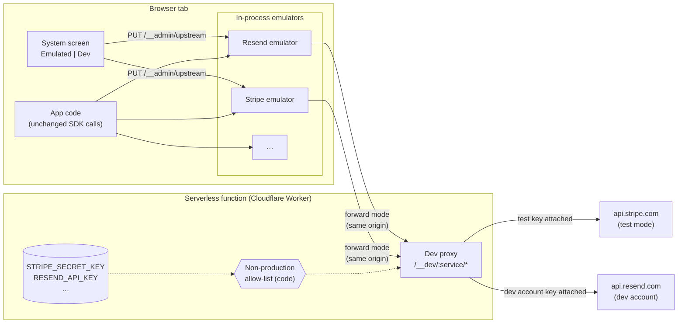
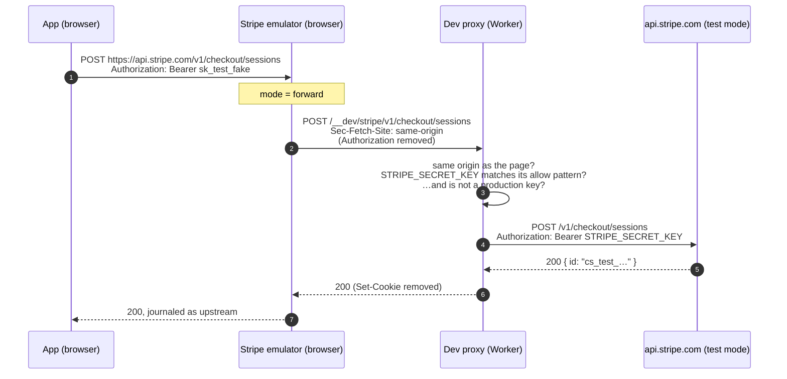

# Dev resources

Run an app against its emulators, then point any one third-party service at a real
**non-production** resource (Stripe test mode, Junction's sandbox, your dev Resend account)
without rebuilding, redeploying, or putting a credential in the browser. Production is never
reachable: every credential must match a non-production allow-list you write, and known
production formats are refused regardless.

Every emulator in a browser preview starts **Emulated**: it answers in-process, with fictional
data. The System screen lists every service the app uses and switches each one, independently,
to **Dev**. From then on that emulator forwards the app's requests to the real resource through a
small proxy that holds the credentials. Switch it back and the emulator answers again. Nothing
else about the app changes: the same code, the same SDK calls, the same URLs.

- [How it works](#how-it-works)
- [Production safety](#production-safety)
- [Providers](#providers)
- [Use it in the lab preview](#use-it-in-the-lab-preview)
- [Add it to your own app](#add-it-to-your-own-app)
- [What dev resources do not do](#what-dev-resources-do-not-do)

## How it works



| Piece | Package | Job |
| --- | --- | --- |
| Forward mode | every emulator (`@crvouga/mockingbird-service-*`) | `createRuntime({ upstream })` gives the emulator a transport; `PUT /__admin/upstream {"mode":"forward"}` sends its requests there instead of answering them. The journal still records each one, marked `upstream`. |
| Dev resources client | `@crvouga/mockingbird-preview` (`createDevResources`) | Builds each emulator's transport to the proxy on the page's own origin, remembers the chosen modes, and gives the System screen its service controls. It never holds a credential. |
| Dev proxy | `@crvouga/mockingbird-preview/dev-proxy` (`createDevProxy`, `devProxyWorker`) | A Fetch handler that maps `/<service>/<path>` to that service's resource, checks every credential against the allow-list, attaches them, and relays the response. Runs on Cloudflare Workers, Bun, Node or Deno. |
| System screen | `@crvouga/mockingbird-ui` (`mountSystemHarness`) | Lists the apps (their order and which ones the switcher visits) and the services, each with **Emulated \| Dev** and, when Dev is unavailable, why. |

One request with Stripe on **Dev**:



## Production safety

The proxy is the only place a credential exists, and it is deny-by-default at every step:

1. **Nothing is allowed until you allow it.** `createDevProxy({ allow })` takes a pattern for
   every value a provider reads: its credentials, the identifiers it targets (a Twilio account
   SID, an FCM project) and any base-URL override. A provider with a value that has no pattern,
   or whose value does not match, is blocked: its relays answer `403 not_allowed` and the System
   screen shows why. The patterns live in code, so a change to what may be reached is a reviewed
   commit, never an environment variable.
2. **Patterns must be anchored.** A pattern that does not start with `^` and end with `$` throws
   when the proxy is created, so a loose regex cannot match more than you meant.
3. **Production formats are refused anyway.** Each provider can list known production formats
   (Stripe `sk_live_…`/`rk_live_…`). Those are refused even when an allow pattern matches them.
4. **Use the vendor's own proof where it exists.** `NON_PROD_PATTERNS` holds formats that prove a
   credential is non-production: Stripe test keys (`sk_test_`/`rk_test_`), Junction sandbox keys
   (`sk_us_`/`sk_eu_`). Spread it into `allow` to opt in. Resend, Twilio, Slack and FCM keys look
   the same in production, so pin something only your dev account has: `TWILIO_ACCOUNT_SID:
   /^AC<dev SID>$/`, `FCM_PROJECT_ID: /^my-app-dev$/`, or a pattern for a dev-only key.
5. **Same origin only; credentials stay server-side.** The proxy is part of the app's dev
   instance, served from the same origin as the page, and it trusts that page: a request is
   relayed only when the browser marks it `Sec-Fetch-Site: same-origin` (and any `Origin` is the
   proxy's own). Other sites, and clients that do not say where they come from, get `403`. There
   is no key to enter and nothing secret in the browser: the proxy injects the credentials
   itself. Anyone who can open the preview can therefore use its dev resources through the app,
   as with any dev instance. To limit who can open previews, put an access policy such as
   Cloudflare Access in front of them; the app needs no change.
6. **Allow-listed hosts only.** Each provider maps paths to its own hosts. An unknown service is
   `404`, a path the provider does not relay is `501`. It is not an open proxy.
7. **Nothing leaks back.** The browser's `Authorization`, cookies, `x-mockingbird-*`, `Origin`,
   `Referer` and forwarding headers are stripped on the way out; `Set-Cookie` on the way back.
   Credential values are redacted from text and JSON responses. The manifest
   (`GET /__dev/`) says which values are missing or blocked, never what they are.

## Providers

| Service | Reaches | Values it reads | Non-production proof |
| --- | --- | --- | --- |
| `stripe` | `api.stripe.com` | `STRIPE_SECRET_KEY` | `NON_PROD_PATTERNS` (test keys); live keys always refused |
| `junction` | `api.sandbox.tryvital.io` (`api.sandbox.eu.tryvital.io` for `sk_eu_` keys) | `JUNCTION_API_KEY` | `NON_PROD_PATTERNS` (sandbox keys) |
| `resend` | `api.resend.com` | `RESEND_API_KEY` | pin your dev key's pattern |
| `twilio` | `api.twilio.com`, `verify.twilio.com`, `lookups.twilio.com`, `messaging.twilio.com` | `TWILIO_ACCOUNT_SID`, `TWILIO_AUTH_TOKEN` | pin your dev account's SID; `/Accounts/<sid>/` is rewritten to it |
| `fcm` | `fcm.googleapis.com` (`messages:send` only) | `FCM_PROJECT_ID`, `FCM_ACCESS_TOKEN` | pin your dev project id; the token is short-lived |
| `slack` | `slack.com` (`/api/*` only) | `SLACK_BOT_TOKEN` | pin your dev workspace bot's token pattern |

A provider's host can point at a self-hosted dev instance with `<SERVICE>_BASE_URL`
(`RESEND_BASE_URL`, `JUNCTION_BASE_URL`, …), but only when `allow` has an anchored pattern for that
name too. Services without a provider (sign-in redirects, the in-browser PostgreSQL) stay
emulated, and the System screen says why. A provider is a small object; see the
[preview package README](../packages/adapters/preview/README.md#dev-resources) to write one.

## Use it in the lab preview

Every same-repository PR's lab preview (`mockingbird-lab-pr-<n>`) runs the proxy at `/__dev`. Its
allow-list is in [`src/worker.ts`](../packages/examples/medical-testing/src/worker.ts): Stripe test
keys and Junction sandbox keys out of the box. The
[System preview workflow](../.github/workflows/system-preview.yml) copies whichever of these
GitHub Actions secrets exist to that Worker after each deploy (see [Secrets](SECRETS.md)):

```bash
gh secret set STRIPE_SECRET_KEY        # sk_test_…; and any other provider's values you want available
```

Then open the PR's preview, press **←** to reach **System**, and switch a service to **Dev**. The choice is remembered in that browser and
applied again on the next load; the emulators themselves start fresh on every load.

Locally, run the same Worker with credentials in a gitignored `.dev.vars`:

```bash
bunx turbo run preview:build --filter=@crvouga/mockingbird-example-medical-testing
cd packages/examples/medical-testing
printf 'STRIPE_SECRET_KEY=sk_test_…\n' > .dev.vars
bunx wrangler dev
```

## Add it to your own app

1. **Give each emulator a transport** when you create it, and **pass the controls** to the System
   screen:

   ```ts
   import { createDevResources } from "@crvouga/mockingbird-preview"
   import { createRuntime as createStripe } from "@crvouga/mockingbird-service-stripe"
   import { mountSystemHarness } from "@crvouga/mockingbird-ui"

   const dev = createDevResources({ proxyUrl: "/__dev" })
   const stripe = createStripe({ upstream: dev.upstream("stripe") })

   mountSystemHarness(root, surfaces, {
     services: dev.controls([
       { id: "stripe", label: "Stripe", category: "Payments", admin: (r) => stripe.fetch(r) },
     ]),
   })
   ```

2. **Serve the proxy** next to your preview, with its allow-list. On Cloudflare Workers:

   ```ts
   import { devProviders, devProxyWorker, NON_PROD_PATTERNS } from "@crvouga/mockingbird-preview/dev-proxy"

   type Env = Record<string, string | undefined> & { ASSETS: { fetch(r: Request): Promise<Response> } }
   const proxy = devProxyWorker({
     basePath: "/__dev",
     providers: [devProviders.stripe, devProviders.twilio],
     allow: { ...NON_PROD_PATTERNS, TWILIO_ACCOUNT_SID: /^AC_YOUR_DEV_ACCOUNT_SID$/ },
   })

   export default {
     fetch(request: Request, { ASSETS, ...secrets }: Env) {
       return new URL(request.url).pathname.startsWith("/__dev")
         ? proxy.fetch(request, secrets)
         : ASSETS.fetch(request)
     },
   }
   ```

   with `"main"` pointing at it and `"run_worker_first": ["/__dev", "/__dev/*"]` under `assets` in
   `wrangler.jsonc`, so static files never wake the Worker. Anywhere else,
   `createDevProxy({ providers, allow, env: process.env, basePath: "/__dev" })` is a plain
   `(Request) => Promise<Response>` for `Bun.serve`, Hono, or a Node adapter. Serve it from the
   page's own origin; `allowOrigins` lists any other origin you explicitly trust.

3. **Set the values** on that function: each provider's `<SERVICE>_*` names (`wrangler secret put`, `wrangler secret bulk`, or your platform's secret store).

The lab's own wiring is a working reference:
[`composition/dev.ts`](../packages/examples/medical-testing/src/composition/dev.ts),
[`composition/services.ts`](../packages/examples/medical-testing/src/composition/services.ts),
[`worker.ts`](../packages/examples/medical-testing/src/worker.ts) and
[`wrangler.jsonc`](../packages/examples/medical-testing/wrangler.jsonc).

## What dev resources do not do

- **Your app's identifiers must exist in the dev account.** Stripe price ids, Twilio sender
  numbers and Verify service SIDs, Slack channels and FCM device tokens are whatever your app was
  configured with; the resource rejects ones it does not know.
- **Vendor webhooks are not relayed back.** A real resource's webhooks go to the URL configured in
  that vendor's dashboard, not into a browser tab.
- **Responses are not mirrored into emulator state.** The journal records each forwarded request
  as `upstream`; Resend, Twilio, Slack and FCM also record what they sent, so the notification
  harness shows it. Stripe's and Junction's state views show only what they answered themselves.
- **Not every service has a provider.** Sign-in redirects and the in-browser PostgreSQL stay
  emulated.
- **It is per tab and per load.** Modes are remembered per browser; emulator state is not.
