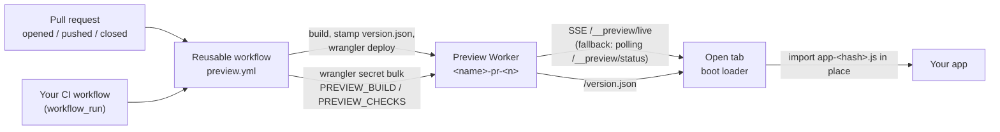
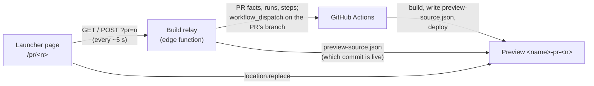

# Live PR previews

Give every pull request a live, self-updating preview of your app on Cloudflare Workers, with one
workflow file and no setup beyond the Cloudflare credentials any hosting needs.

Each preview shows where CI is (a build for a newer commit running, deployed or failed; the PR's
checks running, passed or failed) and updates itself in place when a newer version deploys: an
open tab never needs a reload. The infrastructure is stateless: no database, no Durable Objects,
no GitHub token.

- [How it works](#how-it-works)
- [Use it in your project](#use-it-in-your-project)
- [Inputs](#inputs)
- [Build on demand](#build-on-demand)
- [Freshness for long-lived tabs](#freshness-for-long-lived-tabs)
- [What a preview does not do](#what-a-preview-does-not-do)

## How it works



- **Status is pushed by CI into the Worker itself.** When a build starts, deploys or fails, and
  when your CI workflow starts or finishes for the PR, the workflow writes `PREVIEW_BUILD` or
  `PREVIEW_CHECKS` into the preview Worker's configuration with `wrangler secret bulk`, using the
  Cloudflare credentials it already has. Cloudflare rolls a new version of the same Worker with
  the new value; nothing else stores state.
- **The Worker is a stateless function.** `createPreviewWorker` from `@crvouga/mockingbird-preview`
  serves your static build and `/__preview/*`: the status from its own configuration plus the
  deployed version from `version.json`, as JSON and as short-lived Server-Sent Events that the
  browser reconnects to (so a new Worker version reaches open tabs within about 25 s). Without SSE
  the tab polls `/__preview/status` itself, faster while a build runs. Requests from other sites
  are refused.
- **Updates without reloading.** `index.html` loads a small boot loader that never changes.
  `version.json`, stamped with the PR head at deploy, names your app's hashed entry. When a newer
  one is live, the loader unmounts the running app and imports the new one into the same page,
  after a short countdown (**Update now** / **Not now**), or at once in a background tab. A lazy
  chunk that a deploy removed also triggers the update.
- **Freshness everywhere**, when your app uses `mountSystemHarness` from `@crvouga/mockingbird-ui`
  with the `build` the boot loader passes: a status dot on the switcher, an update toast, and a
  Preview card on the System screen (this tab's version and age, the latest deploy, build and
  checks with links, the connection).

## Use it in your project

1. **Export `start` from your app's entry.** It mounts the app and returns a disposer:

   ```ts
   // src/preview-app.ts
   export const start = async (host: HTMLElement, options: { build?: unknown }) => {
     const unmount = mountMyApp(host, options) // pass options.build to mountSystemHarness if you use it
     return () => unmount()
   }
   ```

2. **Build the preview** with the package's helper (a script your `build` input runs):

   ```ts
   // scripts/build-preview.ts
   import { buildPreview } from "@crvouga/mockingbird-preview/build"
   await buildPreview({ entry: "src/preview-app.ts", outdir: "preview-dist", title: "My app preview" })
   ```

3. **Add one workflow** and the two secrets `CLOUDFLARE_API_TOKEN` and `CLOUDFLARE_ACCOUNT_ID`:

   ```yaml
   # .github/workflows/preview.yml
   name: Preview
   on:
     pull_request: { types: [opened, synchronize, reopened, closed] }
     workflow_run: { workflows: [CI], types: [requested, completed] }   # your CI workflow's name
   permissions: { contents: read, pull-requests: write }
   jobs:
     preview:
       uses: crvouga-organization/mockingbird/.github/workflows/preview.yml@main
       with:
         name: my-app
         build: bun scripts/build-preview.ts
         outdir: preview-dist
       secrets:
         CLOUDFLARE_API_TOKEN: ${{ secrets.CLOUDFLARE_API_TOKEN }}
         CLOUDFLARE_ACCOUNT_ID: ${{ secrets.CLOUDFLARE_ACCOUNT_ID }}
   ```

That is all. The workflow generates the Worker's wrangler config (the package's Worker serving
`outdir`), deploys `my-app-pr-<n>`, puts a **Preview** link at the top of the PR, keeps the
preview's status live, and deletes the Worker when the PR closes. Forks get no secrets, so their
PRs are skipped. The lab in this repo uses exactly this
([system-preview.yml](../.github/workflows/system-preview.yml)), with its own Worker to add the
[dev resources](DEV_RESOURCES.md) proxy.

## Inputs

| Input | Default | What it does |
| --- | --- | --- |
| `name` | (required) | Worker name prefix; each PR deploys `<name>-pr-<number>`. |
| `build` | (required) | Builds the preview into `outdir`. |
| `outdir` | (required) | The built preview, relative to `working-directory`. |
| `working-directory` | `.` | Where install, build, the CLI and wrangler run. |
| `install` | `bun install --frozen-lockfile` | Installs dependencies, including `@crvouga/mockingbird-preview`. |
| `wrangler-config` | generated | Your own wrangler config, for a custom Worker built on `createPreviewWorker`. |
| `cli` | `bunx mockingbird-preview` | How to run the package's CLI (`stamp`, `wrangler-config`). |
| `bun-version` / `wrangler` | `1.4.0` / `bunx wrangler@4.50.0` | Tool versions. |

Secrets are passed explicitly, never with `secrets: inherit`, so the workflow sees only what you
hand it: the two Cloudflare values, and optionally `WORKER_SECRETS`, `KEY=value` lines to set on
the preview Worker (for example [dev resources](DEV_RESOURCES.md) credentials):

```yaml
       secrets:
         CLOUDFLARE_API_TOKEN: ${{ secrets.CLOUDFLARE_API_TOKEN }}
         CLOUDFLARE_ACCOUNT_ID: ${{ secrets.CLOUDFLARE_ACCOUNT_ID }}
         WORKER_SECRETS: |
           STRIPE_SECRET_KEY=${{ secrets.STRIPE_SECRET_KEY }}
```

## Build on demand

Building every push pays for previews nobody opens. Instead, link each PR to a **launcher page**
that builds the preview when someone opens it:



1. **The relay.** `createBuildRelay()` from `@crvouga/mockingbird-preview/on-demand`, with the
   GitHub Actions provider and a token that may read pull requests and actions and dispatch the
   workflow, served from any Fetch runtime. It answers a `PreviewLaunch` (`idle`, `queued`,
   `building`, `publishing`, `live`, `failed`, `unsupported`, `closed` or `unavailable`) for the
   PR's current head commit, starts at most one build per commit, gives up after three failed
   attempts, refuses new builds over a repository-wide cap of eight, and never returns the token,
   the PR title, the branch or a provider error.
2. **The workflow** takes a `workflow_dispatch` input named `pull_request`, builds the PR's branch
   and writes `preview-source.json` (`createPreviewSourceFile`) next to the index, so the relay can
   tell which commit is live. A branch created before the input existed answers `unsupported`:
   merging the base branch fixes it. Give it `concurrency: preview-${{ inputs.pull_request }}`.
3. **The launcher page.** `mountPreviewLauncher` from `@crvouga/mockingbird-ui/launcher`, served
   by your static host at `/pr/<n>`: it starts the build, shows the steps, elapsed time and a
   progress estimate, offers the previous live version meanwhile, and opens the preview when it
   is ready.

Only open, same-repository PRs are built, and only on their own branch, so PR code never writes
the base branch's caches. The full state table is in the
[preview package README](../packages/adapters/preview/README.md#on-demand-previews).

## Freshness for long-lived tabs

A tab open for hours should know when the code it runs was replaced. Each build carries an
identity (`{ commit, builtAt, parts }`, a content pin per app) and publishes a small status
document next to the deployment (`createFreshnessStatusFile`, served `no-store` with open CORS)
saying which build is current and what is happening to the next one. On the page,
`watchFreshness()` polls it every 30 s while visible (never while hidden, at once on focus) and
answers `current`, `newer-live` (naming the apps whose part changed), `newer-building`,
`newer-failed` or `unknown`. `mountFreshnessIndicator` and `freshnessBuild` from
`@crvouga/mockingbird-ui` show it as a quiet dot on the switcher and a line with **Update now**,
**What changed** and **Keep this version**. When only one app's part changed, Update now hands
your app that one app to swap; otherwise it reloads the shell. Keeping emulator and database state
across that reload is up to your app's snapshot support.

## Your own lifecycle

Driving Cloudflare Previews yourself instead of the workflow? The package exports pure helpers for the
same decisions. `explainPreviewAction(pullRequest, builtCommit)` deploys, removes, or skips with a
reason (`fork`, `stale-head`, `no-build`) and a message for your log or PR comment;
`selectBranchAction({ head }, builtCommit)` deploys the branch the Worker serves only from its
current head. `planPreviewSweep` lists previews to remove; pass `capacityCounts: "all"` to count
previews it does not manage against `capacity` too. See the
[package README](../packages/adapters/preview/README.md).

## What a preview does not do

- **Checks status starts once the caller file is on your default branch.** GitHub runs
  `workflow_run` from the default branch only.
- **A status change reaches open tabs within about 25 s.** It lands in a new Worker version,
  which an open SSE stream picks up when it reconnects; polling tabs see it on their next poll.
- **A new version starts a fresh app.** Anything your app keeps in memory is gone after an
  in-place update; what it keeps in `localStorage` stays.
