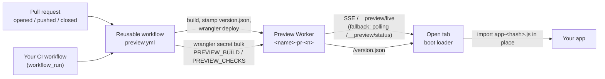

# Live PR previews

Give every pull request a live, self-updating preview of your app on Cloudflare Workers, with one
workflow file and no setup beyond the Cloudflare credentials any hosting needs.

Each preview shows where CI is (a build for a newer commit running, deployed or failed; the PR's
checks running, passed or failed) and updates itself in place when a newer version deploys: an
open tab never needs a reload. The infrastructure is stateless: no database, no Durable Objects,
no GitHub token.

- [How it works](#how-it-works)
- [Use it in your project](#use-it-in-your-project)
- [Inputs](#inputs)
- [Previews of several apps: shared parts](#previews-of-several-apps-shared-parts)
- [What a preview does not do](#what-a-preview-does-not-do)

## How it works



- **Status is pushed by CI into the Worker itself.** When a build starts, deploys or fails, and
  when your CI workflow starts or finishes for the PR, the workflow writes `PREVIEW_BUILD` or
  `PREVIEW_CHECKS` into the preview Worker's configuration with `wrangler secret bulk`, using the
  Cloudflare credentials it already has. Cloudflare rolls a new version of the same Worker with
  the new value; nothing else stores state.
- **The Worker is a stateless function.** `createPreviewWorker` from `@crvouga/mockingbird-preview`
  serves your static build and `/__preview/*`: the status from its own configuration plus the
  deployed version from `version.json`, as JSON and as short-lived Server-Sent Events that the
  browser reconnects to (so a new Worker version reaches open tabs within about 25 s). Without SSE
  the tab polls `/__preview/status` itself, faster while a build runs. Requests from other sites
  are refused.
- **Updates without reloading.** `index.html` loads a small boot loader that never changes.
  `version.json`, stamped with the PR head at deploy, names your app's hashed entry. When a newer
  one is live, the loader unmounts the running app and imports the new one into the same page,
  after a short countdown (**Update now** / **Not now**), or at once in a background tab. A lazy
  chunk that a deploy removed also triggers the update.
- **Freshness everywhere**, when your app uses `mountSystemHarness` from `@crvouga/mockingbird-ui`
  with the `build` the boot loader passes: a status dot on the switcher, an update toast, and a
  Preview card on the System screen (this tab's version and age, the latest deploy, build and
  checks with links, the connection).

## Use it in your project

1. **Export `start` from your app's entry.** It mounts the app and returns a disposer:

   ```ts
   // src/preview-app.ts
   export const start = async (host: HTMLElement, options: { build?: unknown }) => {
     const unmount = mountMyApp(host, options) // pass options.build to mountSystemHarness if you use it
     return () => unmount()
   }
   ```

2. **Build the preview** with the package's helper (a script your `build` input runs):

   ```ts
   // scripts/build-preview.ts
   import { buildPreview } from "@crvouga/mockingbird-preview/build"
   await buildPreview({ entry: "src/preview-app.ts", outdir: "preview-dist", title: "My app preview" })
   ```

3. **Add one workflow** and the two secrets `CLOUDFLARE_API_TOKEN` and `CLOUDFLARE_ACCOUNT_ID`:

   ```yaml
   # .github/workflows/preview.yml
   name: Preview
   on:
     pull_request: { types: [opened, synchronize, reopened, closed] }
     workflow_run: { workflows: [CI], types: [requested, completed] }   # your CI workflow's name
   permissions: { contents: read, pull-requests: write }
   jobs:
     preview:
       uses: crvouga-organization/mockingbird/.github/workflows/preview.yml@main
       with:
         name: my-app
         build: bun scripts/build-preview.ts
         outdir: preview-dist
       secrets:
         CLOUDFLARE_API_TOKEN: ${{ secrets.CLOUDFLARE_API_TOKEN }}
         CLOUDFLARE_ACCOUNT_ID: ${{ secrets.CLOUDFLARE_ACCOUNT_ID }}
   ```

That is all. The workflow generates the Worker's wrangler config (the package's Worker serving
`outdir`), deploys `my-app-pr-<n>`, puts a **Preview** link at the top of the PR, keeps the
preview's status live, and deletes the Worker when the PR closes. Forks get no secrets, so their
PRs are skipped. The lab in this repo uses exactly this
([system-preview.yml](../.github/workflows/system-preview.yml)), with its own Worker to add the
[dev resources](DEV_RESOURCES.md) proxy.

## Inputs

| Input | Default | What it does |
| --- | --- | --- |
| `name` | (required) | Worker name prefix; each PR deploys `<name>-pr-<number>`. |
| `build` | (required) | Builds the preview into `outdir`. |
| `outdir` | (required) | The built preview, relative to `working-directory`. |
| `working-directory` | `.` | Where install, build, the CLI and wrangler run. |
| `install` | `bun install --frozen-lockfile` | Installs dependencies, including `@crvouga/mockingbird-preview`. |
| `wrangler-config` | generated | Your own wrangler config, for a custom Worker built on `createPreviewWorker`. |
| `cli` | `bunx mockingbird-preview` | How to run the package's CLI (`stamp`, `wrangler-config`). |
| `bun-version` / `wrangler` | `1.4.0` / `bunx wrangler@4.50.0` | Tool versions. |

Secrets are passed explicitly, never with `secrets: inherit`, so the workflow sees only what you
hand it: the two Cloudflare values, and optionally `WORKER_SECRETS`, `KEY=value` lines to set on
the preview Worker (for example [dev resources](DEV_RESOURCES.md) credentials):

```yaml
       secrets:
         CLOUDFLARE_API_TOKEN: ${{ secrets.CLOUDFLARE_API_TOKEN }}
         CLOUDFLARE_ACCOUNT_ID: ${{ secrets.CLOUDFLARE_ACCOUNT_ID }}
         WORKER_SECRETS: |
           STRIPE_SECRET_KEY=${{ secrets.STRIPE_SECRET_KEY }}
```

## System previews: one registry, content-addressed parts, per-app updates

A preview that runs a whole system in one tab (several web apps, backends and emulators) declares
its apps once and lets the library do the rest. Every app (and every backend) ships as one
**part**: its built files, published under `parts/<app>/<pin>/…` next to a `part.json` index whose
SHA-256 is the part's pin. The pin depends only on the bytes, so it is the same pin the shell
loads, the dev loop swaps, and a deploy shares across previews. Two manifests point at parts:

| Manifest             | Read by                  | Per app                                          |
| -------------------- | ------------------------ | ------------------------------------------------ |
| `parts.json`         | the shell, in the tab    | `entry`, `pin`, gzip `bytes`, backends, prefetch |
| `preview-parts.json` | the deploy and the sweep | input hash, `pin`, `part.json` size              |

- **One declaration per app.** `defineSystem({ apps, backends })` from `@crvouga/mockingbird-ui`
  lists each app's id, label, route, part, the backends and emulators it calls, whether it is on
  by default, and whether it mounts inline or in an isolated iframe. `mountSystem(host, system)`
  derives the switcher, the System screen (with each app's backends and health, and which apps
  call which backend), deep-link routes and the build's part list from it. Duplicate ids and two
  apps on the same route are rejected when the registry is defined, so the build fails.
- **Lazy by default.** `buildPreviewParts` (`@crvouga/mockingbird-preview/node`) builds each app
  into its content-addressed part and writes `parts.json`, failing the build when the shell or a
  part is over its gzip budget. A cold visit loads the shell and the one app opened, and boots
  only the backends that app calls (`createBackendHost` boots each backend on its first request
  and reports `not started` until then). Parts marked `prefetch` load while the tab is idle. A
  part loads once, and a part whose pin did not change is never fetched again.
- **Shared across previews.** `buildPreviewPartSet` also returns the parts, each with the input
  hash of the files it was built from. A pull request that touches one app rebuilds and uploads
  only that app; a part two PRs produce identically is uploaded once; unreferenced parts are
  deleted after a retention window; and the shell can verify each part's size and SHA-256 against
  its pin before running it (`loadPreviewPart`). A host without shared storage falls back to
  uploading every part.
  1. Plan with the input hashes:
     `planPreviewParts({ base, candidate: { web: "…", admin: "…" }, hosted: await host.listParts() })`.
  2. Build only the apps in `plan.build` (or wrap other build output with
     `createPreviewPart({ app, input, files })`).
  3. Plan again with `built`, make the manifest with
     `createPreviewPartsManifest({ commit, parts: plan.parts })` and publish it with
     `deployPreviewParts({ host, preview, manifest, built })`.
  4. After `planPreviewSweep` removes previews, run `sweepPreviewParts` with the same names.
- **Update one app, keep the rest.** `preview.applyManifest(next)` swaps only the apps and
  backends whose pin changed. A changed app is remounted while the others keep their DOM and
  state; a changed backend boots beside the old one, takes new requests once ready, and lets the
  old one drain (bounded, then a typed `PreviewBackendDrainError`). Emulator and database state
  stays. If the new backend fails to boot, the old one keeps serving and the shell offers Retry; a
  change to the shared runtime is refused with a notice saying a reload is needed, and why.
- **Dev loop.** `watchPreviewParts` rebuilds only the parts whose files changed and streams the
  new manifest to the open tab (`partUpdatesResponse` / `followPartUpdates`), which swaps that one
  app in place.

See the [UI package README](../packages/ui/README.md#app-registry), and the preview package
README's [System parts](../packages/adapters/preview/README.md#system-parts) and
[Shared app parts](../packages/adapters/preview/README.md#shared-app-parts) for the API, the host
interface, garbage collection, integrity checks and the Cloudflare flow.

## What a preview does not do

- **Checks status starts once the caller file is on your default branch.** GitHub runs
  `workflow_run` from the default branch only.
- **A status change reaches open tabs within about 25 s.** It lands in a new Worker version,
  which an open SSE stream picks up when it reconnects; polling tabs see it on their next poll.
- **A new version starts a fresh app.** Anything your app keeps in memory is gone after an
  in-place update; what it keeps in `localStorage` stays. A system preview fed load manifests
  (`applyManifest`) restarts only the apps whose part changed.
- **The deployed boot loader still swaps whole versions.** Per-app swaps run when you feed
  `applyManifest` yourself (the dev loop, or your own freshness signal); the reusable workflow's
  boot loader does not read `parts.json` yet.
- **A backend request counts as in flight until its response body is read or cancelled.** A
  response nobody reads holds the old generation until the drain deadline.
