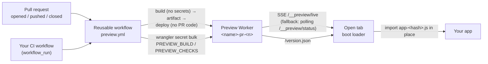
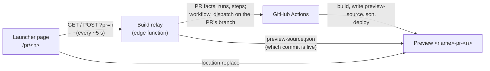

# Live PR previews

Give every pull request a live, self-updating preview of your app on Cloudflare Workers (or
Vercel), with one workflow file and no setup beyond the credentials any hosting needs.

Each preview shows where CI is (a build for a newer commit running, deployed or failed; the PR's
checks running, passed or failed) and updates itself in place when a newer version deploys: an
open tab never needs a reload. The infrastructure is stateless: no database, no Durable Objects,
no GitHub token.

- [How it works](#how-it-works)
- [Use it in your project](#use-it-in-your-project)
- [Inputs](#inputs)
- [What a pull request can reach](#what-a-pull-request-can-reach)
- [Only build what changed](#only-build-what-changed)
- [Runner, toolchain and caches](#runner-toolchain-and-caches)
- [Asset limits and large files](#asset-limits-and-large-files)
- [The PR link](#the-pr-link)
- [Hosting on Vercel](#hosting-on-vercel)
- [Named Previews from your own script](#named-previews-from-your-own-script)
- [Named Previews of one assets-only Worker](#named-previews-of-one-assets-only-worker)
- [System previews: one registry, content-addressed parts, per-app updates](#system-previews-one-registry-content-addressed-parts-per-app-updates)
- [Build on demand](#build-on-demand)
- [Freshness for long-lived tabs](#freshness-for-long-lived-tabs)
- [What a preview does not do](#what-a-preview-does-not-do)

## How it works



- **The PR's code builds where there is nothing to steal.** A build job checks out the PR, installs
  and builds it with no secret and a read-only token, stamps `version.json` and uploads the files
  as an artifact. A separate deploy job, which never checks out or runs the PR's code, validates
  that artifact, rechecks the PR is still at that commit and deploys it (see
  [What a pull request can reach](#what-a-pull-request-can-reach)).
- **Status is pushed by CI into the Worker itself.** When a build starts, deploys or fails, and
  when your CI workflow starts or finishes for the PR, the workflow writes `PREVIEW_BUILD` or
  `PREVIEW_CHECKS` into the preview Worker's configuration with `wrangler secret bulk`, using the
  Cloudflare credentials it already has. Cloudflare rolls a new version of the same Worker with
  the new value; nothing else stores state.
- **The Worker is a stateless function.** `createPreviewWorker` from `@crvouga/mockingbird-preview`
  serves your static build and `/__preview/*`: the status from its own configuration plus the
  deployed version from `version.json`, as JSON and as short-lived Server-Sent Events that the
  browser reconnects to (so a new Worker version reaches open tabs within about 25 s). Without SSE
  the tab polls `/__preview/status` itself, faster while a build runs. Requests from other sites
  are refused.
- **Updates without reloading.** `index.html` loads a small boot loader that never changes.
  `version.json`, stamped with the PR head at deploy, names your app's hashed entry. When a newer
  one is live, the loader unmounts the running app and imports the new one into the same page,
  after a short countdown (**Update now** / **Not now**), or at once in a background tab. A lazy
  chunk that a deploy removed also triggers the update. `index.html` loads the loader by absolute
  path (`/preview.js`, or `buildPreview({ base })` under a sub-path) and the loader reads
  `version.json` and each entry from its own directory, so a reload or shared link at any route
  (`/settings/profile`) boots; the live poller reads that same `version.json`.
- **Updates that reset data wait for you.** A preview that keeps its backends' state in the tab
  (a database in IndexedDB, say) stamps the shape of that data with
  `mockingbird-preview stamp --state-version <v>`. When a newer build's `stateVersion` differs (or
  one starts or stops naming one), the toast says "New version abc1234 resets this preview's
  data" and never applies it on its own, not even in a background tab or after a broken lazy
  chunk; the Preview card says the same and, with the System screen's snapshot, offers **Save**
  before **Update now**.
- **Freshness everywhere**, when your app uses `mountSystemHarness` from `@crvouga/mockingbird-ui`
  with the `build` the boot loader passes: a status dot on the switcher, an update toast, and a
  Preview card on the System screen (this tab's version and age, the latest deploy, build and
  checks with links, the connection).

## Use it in your project

1. **Export `start` from your app's entry.** It mounts the app and returns a disposer:

   ```ts
   // src/preview-app.ts
   export const start = async (host: HTMLElement, options: { build?: unknown }) => {
     const unmount = mountMyApp(host, options) // pass options.build to mountSystemHarness if you use it
     return () => unmount()
   }
   ```

2. **Build the preview** with the package's helper (a script your `build` input runs):

   ```ts
   // scripts/build-preview.ts
   import { buildPreview } from "@crvouga/mockingbird-preview/build"
   await buildPreview({ entry: "src/preview-app.ts", outdir: "preview-dist", title: "My app preview" })
   ```

3. **Add one workflow** and the two secrets `CLOUDFLARE_API_TOKEN` and `CLOUDFLARE_ACCOUNT_ID`:

   ```yaml
   # .github/workflows/preview.yml
   name: Preview
   on:
     pull_request: { types: [opened, synchronize, reopened, closed] }
     workflow_run: { workflows: [CI], types: [requested, completed] }   # your CI workflow's name
   # contents: read checks out the code; pull-requests: write puts the preview link in the PR
   # description and reads the PR's head and changed files. Nothing else is needed.
   permissions: { contents: read, pull-requests: write }
   jobs:
     preview:
       uses: crvouga/mockingbird/.github/workflows/preview.yml@main
       with:
         name: my-app
         build: bun scripts/build-preview.ts
         outdir: preview-dist
       secrets:
         CLOUDFLARE_API_TOKEN: ${{ secrets.CLOUDFLARE_API_TOKEN }}
         CLOUDFLARE_ACCOUNT_ID: ${{ secrets.CLOUDFLARE_ACCOUNT_ID }}
   ```

That is all. The workflow generates the Worker's wrangler config (the package's Worker serving
`outdir`), deploys `my-app-pr-<n>`, puts a **Preview** link at the top of the PR, keeps the
preview's status live, and deletes the Worker when the PR closes. Forks get no secrets, so their
PRs are skipped. The lab in this repo uses this, minus the CI `workflow_run` trigger
([system-preview.yml](../.github/workflows/system-preview.yml)), with its own Worker to add the
[dev resources](DEV_RESOURCES.md) proxy.

## Inputs

| Input | Default | What it does |
| --- | --- | --- |
| `mode` | `worker` | `worker`: a Worker per PR, as described above. `named-previews`: see [below](#named-previews-of-one-assets-only-worker). |
| `name` | (required in `worker` mode) | Worker name prefix; each PR deploys `<name>-pr-<number>`. |
| `build` | (required unless `sites` gives it) | Builds the preview into `outdir`. |
| `outdir` | (required unless `sites` gives it) | The built preview, relative to `working-directory`. |
| `hosting` | `cloudflare` | `cloudflare`: a Worker per PR. `vercel`: see [Hosting on Vercel](#hosting-on-vercel). |
| `working-directory` | `.` | Where install, build, the CLI and wrangler run. |
| `install` | by `package-manager` | Installs dependencies, including `@crvouga/mockingbird-preview`. Empty: `bun install --frozen-lockfile`, `pnpm install --frozen-lockfile` or `npm ci`. |
| `wrangler-config` | generated | Your own wrangler config (JSON, JSONC or TOML), for a custom Worker built on `createPreviewWorker`. |
| `cli` | `bunx mockingbird-preview` | How to run the package's CLI (`stamp`, `wrangler-config`, `check`, `host-*`). |
| `bun-version` / `wrangler` | `1.4.0` / `bunx wrangler@4.50.0` | Tool versions. |
| `runs-on` / `timeout-minutes` | `ubuntu-latest` / `30` | The build jobs' runner (a label, or JSON: `["self-hosted", "8-core"]`, `{ "group": "big" }`) and timeout. |
| `package-manager` | `bun` | `bun`, `pnpm` or `npm`: sets up pnpm and Node (`pnpm/action-setup`, `actions/setup-node`) and picks the install. |
| `node-version` / `node-version-file` / `pnpm-version` | none / none / from `packageManager` | Toolchain versions. |
| `cache-paths` / `cache-key-prefix` | none / `preview` | Paths to cache between builds; restored read-only on PRs, saved only on the default branch. |
| `paths` | every push builds | Globs of the files the preview ships; a push changing none of them builds nothing. |
| `link-path` / `pr-link` | `/` / `true` | Where the PR's **Preview** link opens; `false` leaves the PR description alone. |
| `max-file-mib` / `max-files` | the host's | Asset limits the build is checked against before upload. |
| `split-large-files` | `false` | Split files over the per-file limit into verified parts. |
| `host` | none | `hosting: vercel`: serve `<name>-pr-<n>.<host>` (a domain on the Vercel project). |

The workflow's `url` output is the deployed preview's URL, for your own steps.

Secrets are passed explicitly, never with `secrets: inherit`, so the workflow sees only what you
hand it: the two Cloudflare values, and optionally `WORKER_SECRETS`, `KEY=value` lines to set on
the preview Worker (for example [dev resources](DEV_RESOURCES.md) credentials):

```yaml
       secrets:
         CLOUDFLARE_API_TOKEN: ${{ secrets.CLOUDFLARE_API_TOKEN }}
         CLOUDFLARE_ACCOUNT_ID: ${{ secrets.CLOUDFLARE_ACCOUNT_ID }}
         WORKER_SECRETS: |
           STRIPE_SECRET_KEY=${{ secrets.STRIPE_SECRET_KEY }}
```

## What a pull request can reach

A pull request's author controls its code, its lockfile, its install scripts and its build. The
workflow treats all of it as untrusted, same-repository PRs included (contractors, agents and
compromised dependencies are not a trust boundary):

| Job | Runs PR code | Holds |
| --- | --- | --- |
| `preview` / `plan` (decide, status) | no (no checkout) | the deploy credentials, the write token |
| `build` / `build-site` | **yes** | nothing: no secret, `permissions: contents: read` |
| `deploy` / `site` / `remove` / `report` / `sweep` | no | the deploy credentials, `WORKER_SECRETS`, the write token |
| `verify` (named mode checks after upload) | **yes** | nothing |

- **Nothing from the build reaches a credentialed job but files.** The build uploads `outdir` (and,
  on Cloudflare, the Worker bundled by `wrangler deploy --dry-run` plus the wrangler config as
  data) as an artifact. The deploy job validates it before anything else: regular files and
  directories only (a symlink or special file is refused by path), every file within the per-file
  limit, the count within the per-deployment limit.
- **The deploy runs only tools the workflow chose.** On Cloudflare it runs `wrangler` (the
  `wrangler` input, from npm) from an empty directory of its own, on a config rebuilt from an
  allowlist of your wrangler config's settings: the Worker is uploaded already bundled
  (`no_bundle`), and a setting that would run code or read a file in the deploy job (`build`,
  `containers`, `text_blobs`, `wasm_modules`, `data_blobs`, `site`, `env`, …) is either dropped
  because the build job already applied it, or refused by name. On Vercel and in named mode, the
  `mockingbird-preview` CLI comes from a checkout of the PR's **base commit** (the default branch
  for pushes and schedules) installed with `install`, never from the PR's install. So the PR's
  copy of the CLI must exist on your default branch first: a PR that adds the package gets its
  first preview after it merges.
- **The deploy publishes only the PR's current head.** Before deploying it reads the PR
  (`GET /pulls/{n}`) and skips, with a notice, when the PR closed or moved to another commit.
- **What a PR can still reach**: its own preview. On Cloudflare the preview Worker's code is the
  PR's, so it can read `WORKER_SECRETS` at runtime; pass only credentials meant for previews (the
  [dev resources](DEV_RESOURCES.md) sandbox keys), never production ones. It cannot read the
  Cloudflare or Vercel token, the GitHub write token, or another PR's preview.

## Only build what changed

Give `paths` the globs of the files your preview is built from. A push whose changed files match
none of them starts no build, and the preview stays at the last commit that changed what it ships:

```yaml
      with:
        paths: |
          src/**
          package.json
          bun.lock
          !src/**/*.md
```

`*` matches within one path segment, `**` across segments, `!` excludes, and later patterns win.
A pull request being opened compares all its files; a push compares what that push changed. When
the diff is unknown (a new branch, a force push the API cannot compare, more than 300 files) the
preview builds. You can instead filter on your trigger with `on.pull_request.paths`; then also run
the workflow on `closed` without the filter, so closing still deletes the preview, and keep the
`workflow_run` trigger unfiltered, since status updates still need it.

Pushes in quick succession always leave the preview at the newest commit: one build and one deploy
per PR run at a time (a newer one cancels the older), and each deploy rechecks the PR head first. A
build superseded only by commits that change none of `paths` still deploys.

## Runner, toolchain and caches

```yaml
      with:
        runs-on: '["self-hosted", "linux", "8-core"]'   # or a label, or '{ "group": "big" }'
        timeout-minutes: 45
        package-manager: pnpm
        node-version-file: .nvmrc                       # or node-version: 22
        cache-paths: |
          ~/.local/share/pnpm/store
          .turbo
        build: pnpm turbo run preview:build
```

`runs-on` and `timeout-minutes` apply to the build jobs; the deploy jobs are small and run on
`ubuntu-latest`. `package-manager` sets up pnpm (`pnpm-version`, or your `packageManager` field)
and Node (`node-version` / `node-version-file`), and when `install` is empty runs
`pnpm install --frozen-lockfile` (or `npm ci`, or `bun install --frozen-lockfile`). Bun is always
set up, for `bunx wrangler`.

`cache-paths` is restored read-only in every build (`actions/cache/restore`) under a key of
`cache-key-prefix`, the OS, the lockfiles' hash and the commit, falling back to the newest cache
of the same lockfiles, then of any. It is saved only by a build on the default branch: a pull
request never writes a cache the default branch later restores. Add
`push: { branches: [main] }` to your triggers and a push to the default branch builds once,
without deploying, to save it.

## Asset limits and large files

Hosts cap what a static deployment may hold: Workers static assets refuse a file over 25 MiB and
take at most 20 000 files on the free plan. The build job checks `outdir` against these limits
right after the build, and the deploy job checks the artifact again, so an oversized file fails
fast, naming the file, instead of as a late upload error. Raise or lower the limits with
`max-file-mib` / `max-files` (a paid Workers plan allows 100 000 files).

To ship a file over the limit, set `split-large-files: true` (or run
`mockingbird-preview check --outdir dist --split` in your own build). Each file over the limit is
replaced by numbered parts next to a SHA-256 manifest:

```
workers/backend.js   →   workers/backend.js.parts.json, workers/backend.js.part-000, -001, …
```

Load it in the browser with `loadSplitPreviewFile("/workers/backend.js")` from
`@crvouga/mockingbird-preview`: it fetches the parts, checks each part's and the whole file's size
and SHA-256, and returns the original bytes (or fetches the file directly when it was not split).
Run `mockingbird-preview check --outdir dist` locally to see the same preflight.

## The PR link

The workflow keeps one `[Preview](<url><link-path>)` link between
`<!-- system-preview:start -->` and `<!-- system-preview:end -->` at the top of the PR
description. `link-path` (default `/`) is where it opens: give `/?surface=app` if your
`mountSystemHarness` app has a surface with that id, or any other path. A project that manages
its own links block sets `pr-link: false` and writes the link itself from the workflow's `url`
output:

```yaml
jobs:
  preview:
    uses: crvouga/mockingbird/.github/workflows/preview.yml@main
    with: { name: my-app, build: bun scripts/build-preview.ts, outdir: preview-dist, pr-link: false }
    secrets: { ... }
  link:
    needs: preview
    if: needs.preview.outputs.url != ''
    runs-on: ubuntu-latest
    steps:
      - run: echo "Preview at ${{ needs.preview.outputs.url }}"
```

## Hosting on Vercel

`hosting: vercel` hosts each PR's preview as a static Vercel deployment instead of a Worker, with
only Vercel credentials:

```yaml
    uses: crvouga/mockingbird/.github/workflows/preview.yml@main
    with:
      name: my-app
      hosting: vercel
      host: preview.example.com   # optional: <name>-pr-<n>.preview.example.com; else <name>-pr-<n>.vercel.app
      build: bun scripts/build-preview.ts
      outdir: preview-dist
    secrets:
      VERCEL_TOKEN: ${{ secrets.VERCEL_TOKEN }}
      VERCEL_PROJECT_ID: ${{ secrets.VERCEL_PROJECT_ID }}
      VERCEL_ORG_ID: ${{ secrets.VERCEL_ORG_ID }}   # the team, when the project has one
```

- **Deploy.** The `mockingbird-preview host-deploy` command (from the base commit's install)
  uploads the built files with a `vercel.json` (no build, single-page fallback, `no-store` on
  `version.json` and `/__preview/*`), aliases the deployment to the PR's host name, and deletes the
  deployment the alias pointed at before. Closing the PR removes the alias and the deployment.
- **Live status.** Vercel runs no code for a static preview, so the status lives in a file:
  `/__preview/status` holds the same snapshot the Worker serves. A status change (build
  started, deployed or failed; your CI running, passed or failed) creates a new deployment from the
  files Vercel already holds, which uploads only the changed status file, and moves the alias. The
  boot loader finds no `/__preview/live` stream and polls `/__preview/status`, as it does whenever
  Server-Sent Events are unavailable. In-place updates from `version.json` work as on Workers.
- **Limits.** `WORKER_SECRETS` is refused (a static preview cannot use secrets); the asset limits
  default to 100 MiB per file and 15 000 files. If Deployment Protection covers preview
  deployments, pass `VERCEL_AUTOMATION_BYPASS_SECRET` so status writes can read the preview's
  state, and give viewers access as your protection settings require.
- **Evidence.** The Vercel REST calls (`POST /v2/files`, `POST /v13/deployments` with
  `missing_files` retries, `POST /v2/deployments/{id}/aliases`, `GET /v4/aliases/{alias}`,
  `DELETE /v2/aliases/{id}`, `DELETE /v13/deployments/{id}`), the `vercel.json` overrides and the
  default limits follow Vercel's public documentation: a **best guess, not verified** against a
  live Vercel account. The package's `PreviewHosting` interface (`exists`, `deploy`, `setStatus`,
  `remove`) is what another host would implement.

To deploy with your own tooling instead, run `mockingbird-preview stamp` in your build and deploy
`outdir` yourself: `version.json` and the boot loader's in-place updates work on any static host.

## Named Previews from your own script

To deploy without the reusable workflow, use Cloudflare's named Worker Previews from a CI script
with `createCloudflarePreviews` (see the
[package README](../packages/adapters/preview/README.md#api)). You can know a Preview's URL before
you build: `previewOrigin({ previewName, workerName, subdomain: await previews.subdomain() })`,
or `customPreviewOrigin({ previewName, host })` on a custom domain. Run
`servePreviews(null)` (or `servePreviews(host)`) once so the parent Worker serves its Previews;
without it a deploy succeeds and its URL answers 404. `get(name)` confirms a removed Preview is
gone, and `list()` is `[]` before the parent Worker's first deploy.

## Named Previews of one assets-only Worker

`mode: named-previews` is the opt-in alternative for a project that must stay on the Workers free
plan at any traffic and serve every PR under its own domain. Each site is one **assets-only**
Worker you create once (static files, no `main`), with Previews enabled on it. Each pull request
becomes that Worker's named Preview `pr-<n>`, served at `pr-<n>.<host>` through your custom
domain, or at the Preview's own workers.dev URL while that domain's certificate is being issued.
No Worker script is deployed and no per-PR Worker is created: everything goes through
`createCloudflarePreviews` in the `mockingbird-preview` CLI.

```yaml
# .github/workflows/preview.yml
name: Preview
on:
  pull_request: { types: [opened, synchronize, reopened, closed] }
  push: { branches: [main] }        # optional: a `main` Preview, with a strict gate
  schedule: [{ cron: "17 4 * * *" }] # the sweep
  workflow_dispatch:                 # the sweep, by hand
permissions: { contents: read, pull-requests: write, deployments: write }
jobs:
  preview:
    uses: crvouga/mockingbird/.github/workflows/preview.yml@main
    with:
      mode: named-previews
      host: preview.example.com
      sites: >-
        [{ "name": "app", "worker": "my-app-previews", "build": "bun run build", "outdir": "dist",
           "checks": "scripts/preview-checks.ts" },
         { "name": "storybook", "worker": "my-storybook-previews",
           "build": "bunx storybook build", "outdir": "storybook-static" }]
    secrets:
      CLOUDFLARE_API_TOKEN: ${{ secrets.CLOUDFLARE_API_TOKEN }}
      CLOUDFLARE_ACCOUNT_ID: ${{ secrets.CLOUDFLARE_ACCOUNT_ID }}
```

- **Several sites per PR.** `sites` is a JSON array of `{ name, worker?, build?, outdir?, config?,
  host?, checks? }` (missing fields fall back to the inputs of the same name; `worker` to `name`).
  Each site is its own matrix job, so they build and deploy concurrently and one failing does not
  cancel or hold back the others. Without `sites`, `name` / `build` / `outdir` /
  `wrangler-config` / `host` / `checks` make one site.
- **Assets only, refused otherwise.** A site's `config` (your Worker's `wrangler.json(c)`) may
  declare only static-file settings (`name`, `compatibility_date`, `assets.directory`,
  `assets.html_handling`, `assets.not_found_handling`, routes and similar). A `main`, any binding,
  a var or `assets.run_worker_first` fails the deploy before anything is uploaded, so a preview
  can never run billable Worker code. Its `compatibility_date` and asset handling are used for the
  Preview. A `_headers` file in `outdir` is kept; `_redirects` is refused.
- **Proof it is served.** After upload the CLI polls `version.json` (stamped with the commit) at
  the Preview's origin until it names the commit (`waitUntilServing`).
- **Your checks, before and after upload.** `checks` names a module whose default export is
  `(origin, fetch) => Promise<{ name, ok, detail? }[]>`. It is your PR's code, so it never runs
  where the credentials are: it runs first in the build job against the built directory (a gate;
  `fetch` reads the files; `mockingbird-preview gate-preview`), whose results the deploy reads
  (`deploy-preview --gate`), then in a credential-free `verify` job against the deployed origin,
  re-read until it passes or the deadline passes, since the edge moves machine by machine
  (`mockingbird-preview check-preview`). A pull request's gate is
  best effort: a failing one still uploads and the PR says **deployed, but failing its checks**. A
  branch's gate (a `push`) is strict: nothing is uploaded and the last passing deploy keeps
  serving.
- **The PR description.** The workflow owns one block between `<!-- preview:start -->` and
  `<!-- preview:end -->`, kept at the very top of the description: the status (deploying, live,
  deployed but failing its checks, failed, removed, expired), a link to every site, the deployed and
  attempted commits and the run. Text outside the block is never changed. A run that fails before
  upload marks it failed and keeps the previous deployed commit and links, which keep serving.
- **GitHub Deployments.** Each site's deploy is a Deployment in the transient environment
  `preview/<site>/pr-<n>`, `in_progress` then `success` or `failure`, with the run as `log_url`.
  Earlier deployments of the PR are marked inactive and deleted; closing the PR deletes them all.
- **Removal and the sweep.** Closing the PR deletes every site's Preview and confirms it gone. A
  missed close cannot leave an orphan forever: on `schedule` or `workflow_dispatch` the workflow
  runs `mockingbird-preview sweep` for every site's Worker, which removes `pr-<n>` Previews of
  closed PRs, those not deployed for `retention-days` (default 7) and the oldest beyond `capacity`
  (default 80), confirms each gone and fails if any is left. An open PR whose Preview expired says
  so in its description; pushing a commit deploys it again. Previews not named `pr-<n>` (a branch's)
  are never swept.

In `named-previews` mode the live status that needs a Worker script (`/__preview/*`: build and
checks status, Server-Sent Events) is **not available**: an assets-only Worker runs no code, and
`workflow_run` events are ignored. `version.json` is still stamped, so the boot loader's in-place
updates (its `/version.json` poll) keep working.

## System previews: one registry, content-addressed parts, per-app updates

A preview that runs a whole system in one tab (several web apps, backends and emulators) declares
its apps once and lets the library do the rest. Every app (and every backend) ships as one
**part**: its built files, published under `parts/<app>/<pin>/…` next to a `part.json` index whose
SHA-256 is the part's pin. The pin depends only on the bytes, so it is the same pin the shell
loads, the dev loop swaps, and a deploy shares across previews. Two manifests point at parts:

| Manifest             | Read by                  | Per app                                          |
| -------------------- | ------------------------ | ------------------------------------------------ |
| `parts.json`         | the shell, in the tab    | `entry`, `pin`, gzip `bytes`, backends, prefetch |
| `preview-parts.json` | the deploy and the sweep | input hash, `pin`, `part.json` size              |

- **One declaration per app.** `defineSystem({ apps, backends })` from `@crvouga/mockingbird-ui`
  lists each app's id, label, route, part, the backends and emulators it calls, whether it is on
  by default, and whether it mounts inline or in an isolated iframe. `mountSystem(host, system)`
  derives the switcher, the System screen (with each app's backends and health, and which apps
  call which backend), deep-link routes and the build's part list from it. Duplicate ids and two
  apps on the same route are rejected when the registry is defined, so the build fails.
- **Lazy by default.** `buildPreviewParts` (`@crvouga/mockingbird-preview/node`) builds each app
  into its content-addressed part and writes `parts.json`, failing the build when the shell or a
  part is over its gzip budget. A cold visit loads the shell and the one app opened, and boots
  only the backends that app calls (`createBackendHost` boots each backend on its first request
  and reports `not started` until then). Parts marked `prefetch` load while the tab is idle. A
  part loads once, and a part whose pin did not change is never fetched again.
- **Shared across previews.** `buildPreviewPartSet` also returns the parts, each with the input
  hash of the files it was built from. A pull request that touches one app rebuilds and uploads
  only that app; a part two PRs produce identically is uploaded once; unreferenced parts are
  deleted after a retention window; and the shell can verify each part's size and SHA-256 against
  its pin before running it (`loadPreviewPart`). A host without shared storage falls back to
  uploading every part.
  1. Plan with the input hashes:
     `planPreviewParts({ base, candidate: { web: "…", admin: "…" }, hosted: await host.listParts() })`.
  2. Build only the apps in `plan.build` (or wrap other build output with
     `createPreviewPart({ app, input, files })`).
  3. Plan again with `built`, make the manifest with
     `createPreviewPartsManifest({ commit, parts: plan.parts })` and publish it with
     `deployPreviewParts({ host, preview, manifest, built })`.
  4. After `planPreviewSweep` removes previews, run `sweepPreviewParts` with the same names.
- **Update one app, keep the rest.** `preview.applyManifest(next)` swaps only the apps and
  backends whose pin changed. A changed app is remounted while the others keep their DOM and
  state; a changed backend boots beside the old one, takes new requests once ready, and lets the
  old one drain (bounded, then a typed `PreviewBackendDrainError`). Emulator and database state
  stays. If the new backend fails to boot, the old one keeps serving and the shell offers Retry; a
  change to the shared runtime is refused with a notice saying a reload is needed, and why.
- **Dev loop.** `watchPreviewParts` rebuilds only the parts whose files changed and streams the
  new manifest to the open tab (`partUpdatesResponse` / `followPartUpdates`), which swaps that one
  app in place.

See the [UI package README](../packages/ui/README.md#app-registry), and the preview package
README's [System parts](../packages/adapters/preview/README.md#system-parts) and
[Shared app parts](../packages/adapters/preview/README.md#shared-app-parts) for the API, the host
interface, garbage collection, integrity checks and the Cloudflare flow.

## Build on demand

Building every push pays for previews nobody opens. Instead, link each PR to a **launcher page**
that builds the preview when someone opens it:



1. **The relay.** `createBuildRelay()` from `@crvouga/mockingbird-preview/on-demand`, with the
   GitHub Actions provider and a token that may read pull requests and actions and dispatch the
   workflow, served from any Fetch runtime. It answers a `PreviewLaunch` (`idle`, `queued`,
   `building`, `publishing`, `live`, `failed`, `unsupported`, `closed` or `unavailable`) for the
   PR's current head commit, starts at most one build per commit, gives up after three failed
   attempts, refuses new builds over a repository-wide cap of eight, and never returns the token,
   the PR title, the branch or a provider error.
2. **The workflow** takes a `workflow_dispatch` input named `pull_request`, builds the PR's branch
   and writes `preview-source.json` (`createPreviewSourceFile`) next to the index, so the relay can
   tell which commit is live. A branch created before the input existed answers `unsupported`:
   merging the base branch fixes it. Give it `concurrency: preview-${{ inputs.pull_request }}`.
3. **The launcher page.** `mountPreviewLauncher` from `@crvouga/mockingbird-ui/launcher`, served
   by your static host at `/pr/<n>`: it starts the build, shows the steps, elapsed time and a
   progress estimate, offers the previous live version meanwhile, and opens the preview when it
   is ready.

Only open, same-repository PRs are built, and only on their own branch, so PR code never writes
the base branch's caches. The full state table is in the
[preview package README](../packages/adapters/preview/README.md#on-demand-previews).

## Freshness for long-lived tabs

A tab open for hours should know when the code it runs was replaced. Each build carries an
identity (`{ commit, builtAt, parts }`, a content pin per app) and publishes a small status
document next to the deployment (`createFreshnessStatusFile`, served `no-store` with open CORS)
saying which build is current and what is happening to the next one. On the page,
`watchFreshness()` polls it every 30 s while visible (never while hidden, at once on focus) and
answers `current`, `newer-live` (naming the apps whose part changed), `newer-building`,
`newer-failed` or `unknown`. `mountFreshnessIndicator` and `freshnessBuild` from
`@crvouga/mockingbird-ui` show it as a quiet dot on the switcher and a line with **Update now**,
**What changed** and **Keep this version**. When only one app's part changed, Update now hands
your app that one app to swap; otherwise it reloads the shell. Keeping emulator and database state
across that reload is up to your app's snapshot support. A build identity may also carry
`stateVersion` (`createBuildIdentity({ …, stateVersion })`): a newer build with a different one is
marked `resetsData` and `freshnessBuild` never applies it on its own, even with `auto`.

## Your own lifecycle

Driving Cloudflare Previews yourself instead of the workflow? The package exports pure helpers for the
same decisions. `explainPreviewAction(pullRequest, builtCommit)` deploys, removes, or skips with a
reason (`fork`, `stale-head`, `no-build`) and a message for your log or PR comment;
`selectBranchAction({ head }, builtCommit)` deploys the branch the Worker serves only from its
current head. `planPreviewSweep` lists previews to remove; pass `capacityCounts: "all"` to count
previews it does not manage against `capacity` too. See the
[package README](../packages/adapters/preview/README.md).

## What a preview does not do

- **Checks status starts once the caller file is on your default branch.** GitHub runs
  `workflow_run` from the default branch only.
- **A status change reaches open tabs within about 25 s.** It lands in a new Worker version,
  which an open SSE stream picks up when it reconnects; polling tabs see it on their next poll.
- **A new version starts a fresh app.** Anything your app keeps in memory is gone after an
  in-place update; what it keeps in `localStorage` stays. A system preview fed load manifests
  (`applyManifest`) restarts only the apps whose part changed.
- **The deployed boot loader still swaps whole versions.** Per-app swaps run when you feed
  `applyManifest` yourself (the dev loop, or your own freshness signal); the reusable workflow's
  boot loader does not read `parts.json` yet.
- **A backend request counts as in flight until its response body is read or cancelled.** A
  response nobody reads holds the old generation until the drain deadline.
