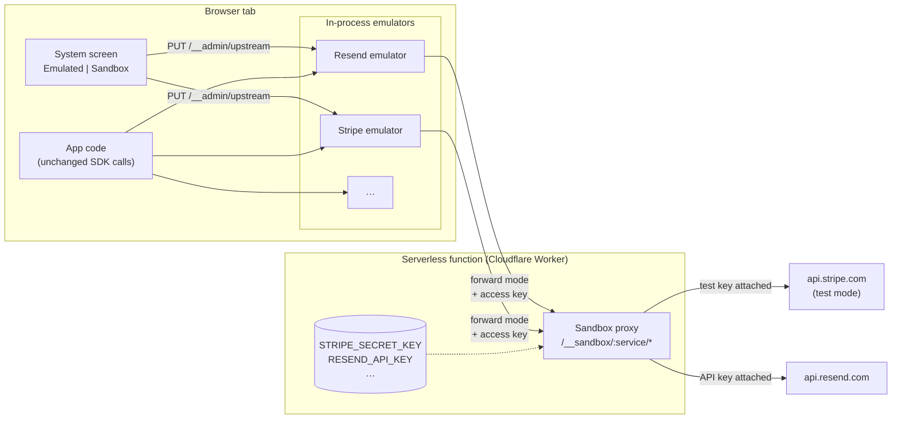
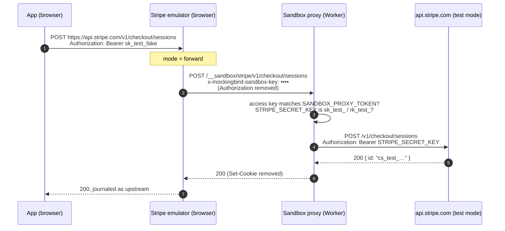

# Sandbox mode

Run an app against its emulators, then flip any one third-party service to the vendor's real
sandbox without rebuilding, redeploying, or putting a secret in the browser.

Every emulator in a browser preview starts **Emulated**: it answers in-process, with fictional
data. The System screen lists every service the app uses and switches each one, independently,
to **Sandbox**. From then on that emulator forwards the app's requests to the vendor's test
account through a small proxy that holds the credentials. Switch it back and the emulator answers
again. Nothing else about the app changes: the same code, the same SDK calls, the same URLs.

- [How it works](#how-it-works)
- [Security model](#security-model)
- [Providers](#providers)
- [Use it in the lab preview](#use-it-in-the-lab-preview)
- [Add it to your own app](#add-it-to-your-own-app)
- [What sandbox mode does not do](#what-sandbox-mode-does-not-do)

## How it works



Three pieces, each in a package so an app only wires them together:

| Piece | Package | Job |
| --- | --- | --- |
| Forward mode | every emulator (`@crvouga/mockingbird-service-*`) | `createRuntime({ upstream })` gives the emulator a transport; `PUT /__admin/upstream {"mode":"forward"}` sends its requests there instead of answering them. The journal still records each one, marked `upstream`. |
| Sandbox client | `@crvouga/mockingbird-preview` (`createSandbox`) | Builds each emulator's transport to the proxy, keeps the viewer's access key and chosen modes, and gives the System screen its service controls. |
| Sandbox proxy | `@crvouga/mockingbird-preview/sandbox-proxy` (`createSandboxProxy`, `sandboxProxyWorker`) | A Fetch handler that maps `/<service>/<path>` to the vendor's sandbox host, attaches that service's secrets, and relays the response. Runs on Cloudflare Workers, Bun, Node or Deno. |
| System screen | `@crvouga/mockingbird-ui` (`mountSystemHarness`) | Lists apps (with which ones the switcher rotates through) and services (with the Emulated/Sandbox control and why sandbox is unavailable when it is). |

One request in sandbox mode:



## Security model

The proxy is the only place a vendor secret exists. Everything about it fails closed:

- **No access key, no relay.** Every relay needs the `x-mockingbird-sandbox-key` header to match
  the proxy's `SANDBOX_PROXY_TOKEN`, compared in constant time. If that secret is not set, the
  proxy refuses every relay (`503`) and the System screen says sandbox mode is off. A preview URL
  is public; without this, anyone who found it could send real email or SMS on your account.
- **The key is per viewer.** It is typed into the System screen once and kept in that browser's
  `localStorage`. It is never in the bundle, the URL, or the repository.
- **Allowlisted hosts only.** Each provider maps paths to its own vendor hosts. An unknown service
  is `404`, a path the provider does not relay is `501`. It is not an open proxy.
- **Sandbox credentials only, where the vendor makes that visible.** Stripe keys must start with
  `sk_test_` or `rk_test_`, and Junction keys with `sk_us_` or `sk_eu_` (its sandbox keys).
  A live key is refused before any request is sent.
- **Nothing leaks back.** The browser's `Authorization`, cookies, `x-mockingbird-*`, `Origin`,
  `Referer` and forwarding headers are stripped on the way out; `Set-Cookie` is stripped on the
  way back. Secret values are redacted from text and JSON vendor responses too. The manifest
  (`GET /__sandbox/`) says which secrets are *missing*, only to a caller with the access key, and
  never their values.

Use sandbox or test-mode credentials only. Anyone holding the access key can spend them.

## Providers

| Service | Sandbox host | Secrets (`<SERVICE>_*`, the same names live parity uses) | Notes |
| --- | --- | --- | --- |
| `stripe` | `api.stripe.com` | `STRIPE_SECRET_KEY` (`sk_test_…`/`rk_test_…`) | `/v1/*` only. Hosted Checkout returns a real `checkout.stripe.com` URL. |
| `junction` | `api.sandbox.tryvital.io` (`api.sandbox.eu.tryvital.io` for `sk_eu_` keys) | `JUNCTION_API_KEY` (`sk_us_…`/`sk_eu_…`) | Order progress comes from Junction's sandbox, not the demo's timers. |
| `resend` | `api.resend.com` | `RESEND_API_KEY` | Sends real email. |
| `twilio` | `api.twilio.com`, `verify.twilio.com`, `lookups.twilio.com`, `messaging.twilio.com` | `TWILIO_ACCOUNT_SID`, `TWILIO_AUTH_TOKEN` | `/Accounts/<sid>/` is rewritten to your SID. Conversations' `/v1/Services` is not relayed (it collides with Messaging's). |
| `fcm` | `fcm.googleapis.com` | `FCM_PROJECT_ID`, `FCM_ACCESS_TOKEN` | Only `messages:send`. The access token is a short-lived OAuth token you refresh. |
| `slack` | `slack.com` | `SLACK_BOT_TOKEN` | `/api/*` only. |

Services without a provider (sign-in redirects, the in-browser PostgreSQL) stay emulated, and the
System screen says why. A provider is a small object (`id`, `label`, `secrets`, `check`, `target`,
`authorize`, and optionally the `methods` it relays and the `identifiers` that are not secret); see the [preview package README](../packages/adapters/preview/README.md#sandbox-mode)
to write one.

## Use it in the lab preview

Every same-repository PR's lab preview (`mockingbird-lab-pr-<n>`) runs the proxy at `/__sandbox`.
The [System preview workflow](../.github/workflows/system-preview.yml) pushes whichever of these
GitHub Actions secrets exist to that Worker after each deploy (see [Secrets](SECRETS.md)):

```bash
gh secret set SANDBOX_PROXY_TOKEN      # any long random string; this is the access key you will type
gh secret set STRIPE_SECRET_KEY        # and any other provider secrets you want available
```

Then open the PR's preview, press **←** to reach **System**, enter the access key under
**Sandbox access**, and switch a service to **Sandbox**. The choice is remembered in that browser
and applied again on the next load; the emulators themselves start fresh on every load.

Locally, run the same Worker with secrets in a gitignored `.dev.vars`:

```bash
bunx turbo run preview:build --filter=@crvouga/mockingbird-example-medical-testing
cd packages/examples/medical-testing
printf 'SANDBOX_PROXY_TOKEN=dev-only\nSTRIPE_SECRET_KEY=sk_test_…\n' > .dev.vars
bunx wrangler dev
```

## Add it to your own app

1. **Give each emulator a transport** when you create it, and **pass the controls** to the System
   screen:

   ```ts
   import { createSandbox } from "@crvouga/mockingbird-preview"
   import { createRuntime as createStripe } from "@crvouga/mockingbird-service-stripe"
   import { mountSystemHarness } from "@crvouga/mockingbird-ui"

   const sandbox = createSandbox({ proxyUrl: "/__sandbox" })
   const stripe = createStripe({ upstream: sandbox.upstream("stripe") })

   mountSystemHarness(root, surfaces, {
     services: sandbox.controls([
       { id: "stripe", label: "Stripe", category: "Payments", admin: (r) => stripe.fetch(r) },
     ]),
   })
   ```

2. **Serve the proxy** next to your preview. On Cloudflare Workers:

   ```ts
   import { sandboxProviders, sandboxProxyWorker } from "@crvouga/mockingbird-preview/sandbox-proxy"

   type Env = Record<string, string | undefined> & { ASSETS: { fetch(r: Request): Promise<Response> } }
   const proxy = sandboxProxyWorker({ basePath: "/__sandbox", providers: [sandboxProviders.stripe] })

   export default {
     fetch(request: Request, { ASSETS, ...secrets }: Env) {
       return new URL(request.url).pathname.startsWith("/__sandbox")
         ? proxy.fetch(request, secrets)
         : ASSETS.fetch(request)
     },
   }
   ```

   with `"main"` pointing at it and `"run_worker_first": ["/__sandbox", "/__sandbox/*"]` under
   `assets` in `wrangler.jsonc`, so static files never wake the Worker.

   Anywhere else, `createSandboxProxy({ providers, env: process.env, basePath: "/__sandbox" })`
   is a plain `(Request) => Promise<Response>` for `Bun.serve`, Hono, or a Node adapter. Serve it
   from the page's own origin, or list the page's origin in `allowOrigins`.

3. **Set the secrets** on that function: `SANDBOX_PROXY_TOKEN` plus each provider's `<SERVICE>_*`
   names (`wrangler secret put`, `wrangler secret bulk`, or your platform's secret store).

The lab's own wiring is a working reference:
[`composition/sandbox.ts`](../packages/examples/medical-testing/src/composition/sandbox.ts),
[`composition/services.ts`](../packages/examples/medical-testing/src/composition/services.ts),
[`worker.ts`](../packages/examples/medical-testing/src/worker.ts) and
[`wrangler.jsonc`](../packages/examples/medical-testing/wrangler.jsonc).

## What sandbox mode does not do

- **Your app's identifiers must exist in the sandbox account.** Stripe price ids, Twilio sender
  numbers and Verify service SIDs, Slack channels and FCM device tokens are whatever your app was
  configured with; the vendor rejects ones it does not know.
- **Vendor webhooks are not relayed back.** A real sandbox's webhooks go to the URL configured in
  that vendor's dashboard, not into a browser tab.
- **Sandbox responses are not mirrored into emulator state.** The journal records each forwarded
  request as `upstream`; Resend, Twilio, Slack and FCM also record what they sent, so the
  notification harness shows it. Other emulators' state views show only what they answered.
- **It is per tab and per load.** Modes and the access key are remembered per browser; emulator
  state is not.
