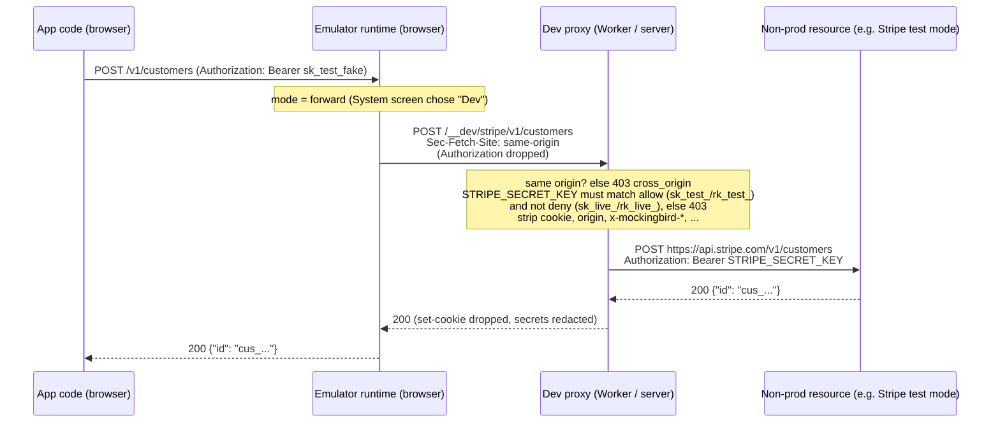
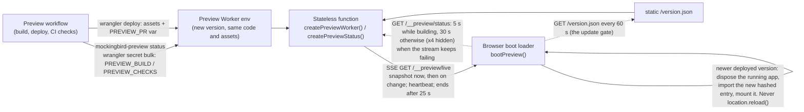

# @crvouga/mockingbird-preview

> Local emulators. Real API contracts. Part of [Mockingbird](https://github.com/crvouga-organization/mockingbird).

Reusable infrastructure for static application previews: a streaming Fetch bridge over MessagePort,
shared worker lifecycle, verified compressed assets, a Node test adapter, and Cloudflare named
Worker Preview deployment. App entrypoints, schemas, synthetic fixtures, credentials acquisition,
cloud identities and organization CI policy remain in the consuming application.

## Install

```sh
npm install @crvouga/mockingbird-preview
```

## Usage

A module worker creates its application once, and attaches each visiting page to that same system:

```ts
import { createPreviewHost, installPreviewWorkerHost } from "@crvouga/mockingbird-preview"

const host = createPreviewHost({
  artifact: "sha256:the-build-identity",
  boot: async ({ generation, signal }) => ({
    fetch: (request) => Response.json({ generation, path: new URL(request.url).pathname }),
    dispose: async () => {},
  }),
  allow: (url) => url.hostname === "app.preview",
})

installPreviewWorkerHost(host, self)
```

The page uses `connectSharedPreviewWorker("/worker.js", { application: "demo", artifact:
"sha256:the-build-identity", generation: 0 })` and its returned `fetch`. The browser's normal
same-origin restrictions apply to the worker URL. Each connected page has isolated in-flight
requests. Disconnecting a page does not dispose the shared system. Call `host.reset()` to abort
connections, dispose state and boot the next generation; reconnect clients afterwards. A failed
boot is visible through `status()` and returns HTTP 503. Calling `dispose()` terminates the host.
The application must honor the boot/request AbortSignals to terminate work it started.

## API

- `createPreviewClient(port, options)` exposes `fetch`, `dispose()` and the number of pending
  requests. `timeoutMs` covers response headers and the complete response stream (30 seconds by
  default); configure it for intentionally long-lived streams. Worker death without a port error
  is detected by this deadline. `allow(url)` optionally restricts destinations at the client.
- `servePreviewPort(port, fetch, options)` handles requests through the application's Fetch
  handler. Responses use transferable ArrayBuffers and one chunk per consumer pull; cancellation
  aborts the handler's signal and reader. Pre-header failures reject fetch and post-header failures
  error its body. Error messages are opaque to avoid leaking server details. `maxRequests`
  bounds concurrent requests per port, default 128. `onClose` supports connection accounting.
- `createPreviewHost({ artifact, boot, allow })` serializes boot/reset/dispose and exposes
  `connect`, `fetch`, `status`, `ready`, `reset` and `dispose`. It owns no emulator-specific state:
  use a fleet's lifecycle inside the boot/dispose callbacks.
- `sharedPreviewWorkerName({ application, artifact, generation })` creates an unambiguous worker
  identity; changing artifact or generation creates a distinct SharedWorker.
- `connectSharedPreviewWorker(url, options)` opens a module SharedWorker and connects its port.
  `connectDedicatedPreviewWorker(url, options)` uses a dedicated module Worker and transferred
  MessageChannel. Both expose `fetch`, `pending`, `worker` and `dispose`; worker errors reject
  pending requests. Dedicated disposal also terminates its worker.
- `installPreviewWorkerHost(host, scope)` accepts SharedWorker connection events and dedicated
  worker MessagePort handshakes. Returns an async disposer.
- `createPreviewArtifact(bytes, { commit, url, encoding })` records format version, source commit,
  exact packed byte count and SHA-256. `parsePreviewArtifact(value)` validates this manifest.
  `digestPreviewBytes(bytes)` returns a lowercase SHA-256 digest.
- `loadPreviewArtifact(manifest, options)` fetches with `no-store`, no credentials and redirect
  refusal; checks expected commit, size and hash before optional gzip decompression. Packed and
  decompressed sizes are bounded by `maximumBytes` (128 MiB default). The result is bytes; the
  caller deliberately chooses how to execute or persist trusted application code. It never evals
  arbitrary fetched source.
- `selectPreviewAction(currentFacts, builtCommit)` chooses deploy/remove/skip from current PR
  state. Closed PRs select removal; forks and stale build heads cannot deploy.
- `planPreviewSweep({ previews, openNames, owns, now, retentionMs, capacity })` is a pure plan
  listing managed names removed for orphaning, expiry or capacity. It never removes unmanaged
  names or performs cloud operations. Capacity eviction retains the newest managed previews.
- `createCloudflarePreviews({ accountId, workerName, token, fetch })` returns `deploy`, `list` and
  `remove`. `deploy` takes explicit static files, source commit, a name and a `currentPullRequest`
  callback. It checks current facts before upload and immediately before deployment, sends only
  missing assets, preserves optional `_headers` text and uses content identity to avoid repeating
  an already identical deployment. `list` follows pages and throws on API failures; `remove`
  treats HTTP 404 as success. No production Worker deployment is changed.
- `previewNodeHandler(fetch)` and `listenPreview(fetch, { port, hostname })`, from the `/node`
  export, expose the same Fetch handler or browser bridge to a Node HTTP test runner. The default
  listener is loopback on an ephemeral port. Responses are always `Cache-Control: no-store` to
  avoid browser worker-asset cache failures. Stream errors destroy the response instead of
  creating a successful EOF. Call the returned `close()` to release the listener.
- `createDevProxy({ providers, env, allow, basePath?, allowOrigins?, trustNonBrowser?, fetch? })`, from
  the `/dev-proxy` export (also re-exported from the package root), is the dev proxy's Fetch
  handler; `devProxyWorker(options)` wraps it as a Cloudflare Worker `{ fetch(request, env) }`.
  `allow` is required: an anchored pattern per env value a provider reads, checked default-deny.
  `devProviders` holds the Stripe, Junction, Resend, Slack, Twilio and FCM providers;
  `NON_PROD_PATTERNS` the vendor formats that by themselves prove a non-production credential;
  and `devBaseUrlName(id)` the `<ID>_BASE_URL` override name. See [Dev resources](#dev-resources).
- `createDevResources({ proxyUrl?, storage?, fetch? })` is the browser side: `upstream(id)` for an
  emulator's `createRuntime({ upstream })` and `controls(services)` for the System screen.
  `DEV_MESSAGES` holds its status sentences and `DEV_STORAGE_KEYS` its storage keys.
- `createPreviewStatus({ env, readVersion, basePath?, sse? })`, from the `/preview-status` export
  (also re-exported from the package root), is a stateless Fetch handler for a preview's CI status,
  read on every call from the Worker env CI writes (`PREVIEW_BUILD`, `PREVIEW_CHECKS`, `PREVIEW_PR`;
  names in `PREVIEW_ENV`): `GET /__preview/status` (one snapshot) and `GET /__preview/live`
  (Server-Sent Events), same-origin only, `undefined` for every other path.
  `parsePreviewBuild(value)`, `parsePreviewChecks(value)` and `parsePreviewPr(value)` validate one
  env value (undefined when missing or malformed); `PREVIEW_STATUS_NO_CI_MESSAGE` is the message of
  a snapshot CI has not reported to. See [Live previews](#live-previews).
- `createPreviewWorker({ basePath?, devProxy? })`, from the `/worker` export, is the generic preview
  Worker `{ fetch(request, env) }`: `/__preview/*` is the CI status (deployed version from the
  `ASSETS` binding's `/version.json`), the optional dev proxy serves its `basePath` with only the
  string env values, and everything else is `env.ASSETS.fetch(request)`. The `/worker-entry` export
  (`dist/worker-entry.js`) default-exports `createPreviewWorker()`, ready to be a wrangler `main`.
- `bootPreview({ host?, versionUrl?, live? })`, from the `/boot` export (browser), is the boot
  loader: it fetches `version.json` (no-store), imports the entry it names, calls its
  `start(host, { build })` and follows every newer deploy with `createLivePreview`. On failure it
  writes a readable message into the host (default `#preview`) and rejects.
- `buildPreview({ entry, outdir, title?, hostId?, esbuild? })` and
  `stampPreviewVersion({ outdir, version, pr?, builtAt? })`, from the `/build` export (Bun / Node;
  `esbuild` is a peer dependency), build the static preview (hashed `app-<hash>.js`, `preview.js`,
  `index.html`, `build.json`, a development `version.json`) and stamp `version.json` with the
  commit a deploy ships. See [Building the preview](#building-the-preview).
- The `mockingbird-preview` CLI (`stamp`, `status`, `wrangler-config`) is what the preview workflow
  runs. See [The CLI](#the-cli).
- `createLivePreview({ current, load, basePath?, versionUrl?, countdownMs?, storage?, … })` is the
  browser side: it mounts `current`, follows the status stream (or polls it), and swaps in each newly deployed
  build without reloading the page. Its result is structurally the UI package's `SystemBuild`
  (pass it to `mountSystemHarness(…, { build })`) plus `start()` and `close()`.
  `isChunkLoadFailure(event)` recognizes a lazy chunk that failed to load, and
  `LIVE_PREVIEW_STORAGE_KEY` is where the auto-update preference persists.
- `createBackendHost({ backends, drainMs? })`, `backendControlHandler(host, { path?, importBackend? })`
  and `backendControls(fetch, { url?, pollMs? })`: lazy, swappable in-tab backends and emulators,
  their control routes, and the tab's client; `PreviewBackendDrainError` and
  `PreviewBackendUpdateError` are their typed failures. See [System parts](#system-parts).
- `PreviewPartsManifest`, `parsePartsManifest`, `gzipSize`, `checkPartBudgets`,
  `formatPartSizes`, `PreviewPartBudgetError`, `partUpdatesResponse` and `followPartUpdates`: the
  parts manifest, its size budgets and its update stream. `buildPreviewParts` and
  `watchPreviewParts`, from the `/node` export (`esbuild` is a peer dependency, loaded on first
  use), build it and run the dev loop. `acceptPreviewFrame()` connects an iframe app to the bridge.

## System parts

A system preview with several apps, backends and emulators loads each one only when it is first
needed, and updates each one alone. The app registry (`defineSystem` / `mountSystem` in
`@crvouga/mockingbird-ui`) declares the apps; this package builds their parts and runs the
backends.

```ts
import { buildPreviewParts } from "@crvouga/mockingbird-preview/node"

declare const system: { parts(): { id: string; source?: string; entry?: string }[] } // defineSystem(...)
await buildPreviewParts({
  parts: system.parts(),
  backends: { api: "backends/api/preview.ts" },
  outdir: "preview-dist",
  shell: ["preview.js"],
  budgets: { shell: 150_000, part: 400_000 },
})
```

- **Parts manifest.** `buildPreviewParts` bundles every part with a `source` to
  `parts/<id>-<pin>.js` (an iframe app also gets `parts/<id>-<pin>.html`), where the pin is the
  content hash of the bytes, so unchanged parts keep their pin and URL across builds and stay
  cached for good. It writes `parts.json`: per app its `entry`, `pin`, gzip `bytes`, `backends`
  and `prefetch`; per backend its `entry`, `pin` and `bytes`; the `runtime` pin (given, or the
  hash of the `shell` files) and `shellBytes`. Parts with only an `entry` are pinned by their
  bytes in `outdir`, or by their URL when served from elsewhere.
- **Budgets.** It prints a size table and throws `PreviewPartBudgetError` (code
  `preview_part_over_budget`, `over` lists each name, size and budget) when the shell or any part
  is over its compressed budget, so the build fails naming the part.
- **Lazy backends.** `createBackendHost` routes each request to the first backend whose `match`
  (a host name, a path prefix or a predicate) accepts it, booting that backend on its first
  request; later requests queue behind the boot. `status()` says `not started`, `starting` (with
  the `progress(fraction, note)` the boot reports), `ready`, `failed` or `updating`; `subscribe`
  fires on every change, and the host is directly a `SystemBackends` for the System screen. A
  failed boot answers 503 `preview_backend_failed` and is retried on the next request. Pass the
  host's `fetch` as the system a `createPreviewHost` boot returns. An emulator is a backend whose
  `boot` creates its runtime, so it too is created on the first request to its host.
- **Swapping a backend.** `replace(id, boot, { drainMs })` boots the new code beside the old one.
  Once it is ready, new requests go to it, and requests already running on the old one (until
  their response body is read or cancelled) finish there. After `drainMs` (default 10 s) the
  remaining ones fail with `PreviewBackendDrainError` (code `preview_backend_drained`) and the old
  generation is disposed. If the new code fails to boot, the old one keeps serving and `replace`
  rejects with `PreviewBackendUpdateError` (code `preview_backend_update_failed`). Other backends,
  emulators and in-memory databases are untouched, so their state survives with no export or
  import. `backendControlHandler` exposes `GET` status and `POST {"ensure": [...]}` /
  `POST {"replace": id, "entry": url}` for a tab whose backends run in a worker; without
  `importBackend`, `replace` answers 501 `preview_backend_replace_unsupported` instead of
  pretending to swap. `backendControls(fetch)` is the tab's client: `list`/`subscribe` for the
  System screen, `ensure` for `mountSystem`'s `ensureBackends`, `replace` for its `replaceBackend`.
- **Dev loop.** `watchPreviewParts(options)` builds once, then watches the files esbuild says each
  part (and backend) is made of, and rebuilds only the parts a change touches (a module shared by
  two apps rebuilds both). A failed rebuild keeps the last good manifest and is recorded in
  `rebuilds()`. Serve its manifests with `partUpdatesResponse(watcher)` (Server-Sent Events) and
  follow them in the tab with `followPartUpdates(url, preview.applyManifest)`; the tab swaps the
  changed app in place.
- **Iframe apps.** Inside an iframe app, `await acceptPreviewFrame()` waits for the shell's
  connect message (only from `parent`, and from `origin` when given) and returns a `fetch` over
  the same bridge inline apps use.

## Cookies, redirects and trust

The bridge defaults to removing Cookie and Set-Cookie headers. It does not borrow browser cookies
or impersonate the page origin. For a fully virtual application, both bridge ends may opt into
`cookies: true`; that carries explicitly supplied cookie headers, but supplies no cookie jar and
never writes `document.cookie`. The host must own a jar per intended user/session if needed.
Responses preserve redirect statuses and Location; redirects are always manual, including when a
Request uses its usual `follow` default. Follow redirects explicitly through the same allowlisted
Fetch boundary. Do not forward authorization/cookies to a new origin. These deliberate rules avoid
silently following an allowed virtual request into a real production host.

Request bodies are buffered before transfer; response bodies stream with backpressure. This is
not a streaming request-upload implementation. Ports are trusted capabilities, not an untrusted
RPC/authentication boundary. Browser-delivered code, environment values and files remain visible
and editable by the visitor. Never put production or shared secret values in these artifacts.

Cloudflare helpers require an existing parent Worker and explicit account credentials on the
trusted CI/server side. They create named Preview resources with base-config inheritance disabled,
no environment bindings, and assets-only deployments. Existing organization ownership/naming
rules remain the caller's responsibility. Per-PR deployment jobs must be serialized externally:
the final head re-read narrows, but cannot eliminate, races without a provider compare-and-swap.
A retry after an ambiguous create response should re-read the named preview before retrying.
No live cloud credentials were used for the package's acceptance tests.

Cloudflare protocol references:
[official Preview API implementation](https://github.com/cloudflare/workers-sdk/blob/main/packages/deploy-helpers/src/preview/api.ts),
[asset upload documentation](https://developers.cloudflare.com/workers/static-assets/direct-upload/),
[Worker Previews](https://developers.cloudflare.com/workers/previews/).

## Dev resources

A preview runs every third-party service as an in-browser emulator. Dev resources let a viewer
flip one service at a time from **Emulated** to **Dev**: that emulator's runtime switches to
forward mode (`PUT /__admin/upstream {"mode":"forward"}`) and sends the app's API calls to a real
**non-production** resource the app's dev instance uses: a Stripe account in test mode,
Junction's sandbox, a dev Resend account, a dev Slack workspace, a self-hosted dev instance. The
browser never holds a credential. A small Fetch handler, the **dev proxy**
(`@crvouga/mockingbird-preview/dev-proxy`), sits next to the static preview, holds the secrets in
its environment and attaches them per request, and only after checking that every one of them is
allowed. It is mounted on the dev app's own origin and trusts that app: there is no access key,
and the client never handles a credential.



### Safety model: default deny

Nothing is reachable until you say, in code, what a non-production value looks like.

- **`allow` is required.** For every env value a provider reads (its secrets, its identifiers and
  any `<ID>_BASE_URL` override) `allow` names the pattern it must match. A provider with an env
  value that has no entry, or does not match it, is **blocked**: the manifest reports why and
  every relay answers `403 { "error": { "code": "not_allowed", "message" } }` without sending
  anything. Patterns must be anchored (`/^…$/`, no `m` flag) or `createDevProxy()` /
  `devProxyWorker()` throws; each is matched against the whole value. They live in code so they
  are reviewed, never in the environment.
- **Known production formats always lose.** A provider can declare `deny` patterns that win over
  `allow`: Stripe refuses `sk_live_` and `rk_live_` keys even under `allow: { STRIPE_SECRET_KEY: /^.+$/ }`.
- **`NON_PROD_PATTERNS`** holds the vendor formats that by themselves prove a non-production
  credential (`STRIPE_SECRET_KEY: /^(sk|rk)_test_[A-Za-z0-9]+$/`,
  `JUNCTION_API_KEY: /^sk_(us|eu)_[A-Za-z0-9_-]+$/`). Resend, Slack, Twilio and FCM credentials
  look the same in production and development, so there is no entry for them: pin an identifier
  (`TWILIO_ACCOUNT_SID: /^AC0123…$/`, `FCM_PROJECT_ID: /^my-app-dev$/`) or write a pattern that
  only your dev credential matches.
- **Reasons never echo values.** `blocked` reads "No allow-list pattern for RESEND_API_KEY",
  "STRIPE_SECRET_KEY does not match its allow-list pattern" or "STRIPE_SECRET_KEY is a production
  credential"; the System screen shows it as the service's reason.
- **Base URL overrides are allow-listed too.** Each provider has a default host. An env value
  `<ID>_BASE_URL` (`RESEND_BASE_URL`, `JUNCTION_BASE_URL`, ...; `devBaseUrlName(id)`) replaces it
  only when `allow` has a matching entry for that name and the value is an `https:` URL without
  query or credentials; a path prefix is kept. Otherwise the provider is blocked. This is how a
  self-hosted dev instance is reached.

| id | Reaches by default | Secrets | Identifiers | `allow` entry |
| --- | --- | --- | --- | --- |
| `stripe` | `api.stripe.com` (`/v1/*`) | `STRIPE_SECRET_KEY` | | `NON_PROD_PATTERNS` (test-mode keys; live keys are denied) |
| `junction` | Junction's sandbox `api.sandbox.tryvital.io` (`api.sandbox.eu.tryvital.io` for `sk_eu_` keys; `/v<n>/*`) | `JUNCTION_API_KEY` | | `NON_PROD_PATTERNS` |
| `resend` | `api.resend.com` | `RESEND_API_KEY` | | pin your dev key, or reach a dev instance via `RESEND_BASE_URL` |
| `slack` | `slack.com` (`/api/*`) | `SLACK_BOT_TOKEN` | | pin your dev workspace's bot token |
| `twilio` | `api.twilio.com`, `verify.twilio.com`, `lookups.twilio.com`, `messaging.twilio.com` (by path) | `TWILIO_ACCOUNT_SID`, `TWILIO_AUTH_TOKEN` | `TWILIO_ACCOUNT_SID` | pin an identifier: `TWILIO_ACCOUNT_SID` (test credentials or a dev subaccount) |
| `fcm` | `fcm.googleapis.com` (`POST /v1/projects/*/messages:send`) | `FCM_ACCESS_TOKEN`, `FCM_PROJECT_ID` | `FCM_PROJECT_ID` | pin an identifier: `FCM_PROJECT_ID` (your dev project) |

Every value in the Secrets column needs an `allow` entry, including the token next to a pinned
identifier (a loose `/^.+$/` is fine there: the pin is what proves non-prod).

Provider notes: Stripe prices, products, coupons and webhook endpoints the app names must exist in
the test-mode account. Junction lab test ids and users must exist in Junction's sandbox team; a
`JUNCTION_BASE_URL` override replaces the EU host switch. Resend really sends email: use a sending
domain and recipients you own. Slack channels and users must exist in the bot's workspace. Twilio
rewrites any `/Accounts/<sid>/` to the configured SID; sender numbers and Messaging / Verify
Service SIDs must exist in that account; `/v1/Services` always goes to Messaging, so Conversations'
`/v1/Services` is not reachable; a `TWILIO_BASE_URL` override replaces only the default API host
(`/2010-04-01/*`), Verify, Lookups and Messaging keep their vendor hosts. FCM rewrites the project
id to `FCM_PROJECT_ID`; the access token is a short-lived OAuth token (about an hour), refresh it
out of band.

For every provider: vendor webhooks are **not** relayed back to the browser emulator, and
forwarded responses are relayed as-is (emulators with a forwarded-response hook, such as Resend,
FCM and Twilio, record a receipt; Stripe and Junction do not mirror remote objects into their
state). A path a provider does not map answers `501`.

### Trust and transport

- **Same-origin only.** The proxy answers a request only when the browser marks it
  `Sec-Fetch-Site: same-origin` and its `Origin`, when sent, is the proxy's own origin (or listed
  in `allowOrigins`, which also turns on CORS for exactly those origins). Cross-site, same-site and
  navigation requests, and a foreign `Origin`, get `403 { "error": { "code": "cross_origin" } }`
  with nothing sent. A request without `Sec-Fetch-Site` (curl, a server, a test) is refused too
  unless the proxy is built with `trustNonBrowser: true`.
- **Who can open the preview is the preview host's job.** Anyone who can load the page can use its
  dev resources, so restrict the preview itself, e.g. with
  [Cloudflare Access](https://developers.cloudflare.com/cloudflare-one/policies/access/) in front
  of the Worker. The allow-list above is what keeps those resources non-production.
- **Fixed hosts only.** Each provider builds the URL on its fixed (or allow-listed override)
  base from the path; a crafted path cannot change the host, and unmapped paths answer `501`.
  Redirects are returned, never followed.
- **Secrets never reach the browser.** The proxy drops the caller's `authorization`, `cookie`,
  `origin`, `referer`, `x-mockingbird-*`, `cf-*`, `x-forwarded-*` and `forwarded` headers,
  attaches the credential itself, drops `set-cookie` from the answer, and redacts every secret
  value from its own errors and from text responses (account identifiers such as the Twilio
  Account SID stay). Errors are `{ "error": { "code", "message" } }`.
- **Modes per viewer.** The browser keeps only the chosen modes in its own `localStorage`.

### Mounting the proxy

A Cloudflare Worker that serves the static preview and the proxy on one origin (set the secrets
with `wrangler secret put STRIPE_SECRET_KEY`, ...):

```ts
import {
  devProviders,
  devProxyWorker,
  NON_PROD_PATTERNS,
} from "@crvouga/mockingbird-preview/dev-proxy"

const proxy = devProxyWorker({
  basePath: "/__dev",
  providers: [devProviders.stripe, devProviders.junction, devProviders.twilio],
  allow: {
    ...NON_PROD_PATTERNS,
    TWILIO_ACCOUNT_SID: /^AC_YOUR_DEV_ACCOUNT_SID$/, // the dev account, pinned
    TWILIO_AUTH_TOKEN: /^[0-9a-f]{32}$/,
  },
})

export default {
  fetch(request: Request, env: Record<string, string | undefined> & { ASSETS: { fetch(request: Request): Promise<Response> } }) {
    const { pathname } = new URL(request.url)
    if (pathname === "/__dev" || pathname.startsWith("/__dev/")) {
      const { ASSETS: _assets, ...secrets } = env
      return proxy.fetch(request, secrets)
    }
    return env.ASSETS.fetch(request)
  },
}
```

A Bun server (Node 18+ and Deno work the same with any Fetch-handler server), secrets from
`.env.local` / the process environment, reaching a self-hosted dev Resend-compatible instance:

```ts
import { createDevProxy, devProviders, NON_PROD_PATTERNS } from "@crvouga/mockingbird-preview/dev-proxy"

const dev = createDevProxy({
  basePath: "/__dev",
  providers: [devProviders.stripe, devProviders.resend],
  env: process.env,
  allow: {
    ...NON_PROD_PATTERNS,
    RESEND_API_KEY: /^re_dev_[A-Za-z0-9_]+$/,
    RESEND_BASE_URL: /^https:\/\/mail\.dev\.example\.com$/,
  },
  allowOrigins: ["http://localhost:5173"], // only when the page is served from another origin
})

Bun.serve({
  port: 8787,
  fetch: (request) =>
    new URL(request.url).pathname.startsWith("/__dev")
      ? dev(request)
      : new Response("Not found", { status: 404 }),
})
```

`GET /__dev/` answers the manifest:
`{ providers: [{ id, label, configured, missing, blocked? }] }`.

### Browser wiring

```ts
import { createDevResources } from "@crvouga/mockingbird-preview"
import { createRuntime as createStripe } from "@crvouga/mockingbird-service-stripe"
import { createRuntime as createResend } from "@crvouga/mockingbird-service-resend"

const dev = createDevResources({ proxyUrl: "/__dev" }) // omit proxyUrl: dev resources not offered

// Each emulator forwards through the proxy when switched to Dev; it boots emulated.
const stripe = createStripe({ upstream: dev.upstream("stripe") })
const resend = createResend({ upstream: dev.upstream("resend") })

// The System screen's service list (`mountSystemHarness(host, surfaces, { services })`).
const services = dev.controls([
  { id: "stripe", label: "Stripe", category: "Payments", admin: (r) => stripe.fetch(r) },
  { id: "resend", label: "Resend", category: "Email", admin: (r) => resend.fetch(r) },
  {
    id: "keycloak",
    label: "Keycloak",
    admin: async () => Response.json({ mode: "emulated" }),
    unsupported: "Runs in this browser; there is no remote dev resource",
  },
])

await services.setMode("stripe", "dev") // throws a readable reason when unavailable
const { dev: status, services: rows } = await services.list()
```

`upstream(id)` gives `{ baseUrl: "<proxy>/<id>", fetch, rewriteAuth }`: `fetch` sends the request
to the proxy as-is (the browser adds `Sec-Fetch-Site`), `rewriteAuth` drops the app's fake
`authorization` and any cookie. `controls()` reads each
emulator's mode from `GET /__admin/upstream`, and its `unavailable` reason follows this order:
the spec's `unsupported`, no proxy configured, proxy unreachable or refusing the page
(`cross_origin`), provider secrets missing, the provider's `blocked` reason. Chosen modes persist per viewer; because emulator state resets on reload, the
first `list()` re-applies stored Dev choices that are still available.

## Live previews

A PR preview that knows what CI is doing to it and moves itself to every new deploy, with no hard
refresh: the open tab shows when a newer commit is building, deployed or failed, the PR's checks,
and how fresh it is, then swaps in the new build in place.

Everything is stateless and nothing reads a GitHub API. CI **pushes** its status into the preview
Worker's own configuration: the preview workflow runs `mockingbird-preview status`, which writes
`PREVIEW_BUILD` or `PREVIEW_CHECKS` with `wrangler secret bulk` using the Cloudflare credentials
the deploy already has. Each write rolls a new Worker version with the same code and assets. The
Worker serves whatever is in its env, plus the deployed build from the static `version.json`.
Realtime is Server-Sent Events from that same function plus polling the client manages itself; no
Durable Object, database, GitHub token or callback URL is involved.



### Using it in your project

One caller workflow; the reusable workflow builds your app, deploys a Worker named after the PR
(`<name>-pr-<number>`), stamps `version.json`, pushes build and checks status, and removes the
preview when the PR closes. Your app module exports
`start(host, { build }): Promise<() => void>`, and your build command calls `buildPreview`.

```yaml
# .github/workflows/preview.yml
name: Preview
on:
  pull_request: { types: [opened, synchronize, reopened, closed] }
  workflow_run: { workflows: [CI], types: [requested, completed] }
jobs:
  preview:
    uses: crvouga-organization/mockingbird/.github/workflows/preview.yml@main
    with: { name: lab, install: bun install --frozen-lockfile, build: bun run preview:build, outdir: preview-dist }
    secrets:
      CLOUDFLARE_API_TOKEN: ${{ secrets.CLOUDFLARE_API_TOKEN }}
      CLOUDFLARE_ACCOUNT_ID: ${{ secrets.CLOUDFLARE_ACCOUNT_ID }}
```

Inputs:

| Input               | Meaning                                                                                 |
| ------------------- | --------------------------------------------------------------------------------------- |
| `name`              | Preview name; Workers are `<name>-pr-<number>`.                                         |
| `working-directory` | Where `install` and `build` run (default the repository root).                          |
| `install`           | Install command.                                                                        |
| `build`             | Build command; it writes the static preview to `outdir` (see `buildPreview`).           |
| `outdir`            | The built preview, relative to `working-directory`.                                     |
| `wrangler-config`   | Optional path to your own wrangler config (e.g. a Worker with a dev proxy).             |
| `bun-version`       | Bun version for the job.                                                                |

The `workflow_run` trigger is what reports your CI checks (`running` on `requested`, `passed` or
`failed` on `completed`) to the preview of that commit's PR. Secrets are passed explicitly, never
with `secrets: inherit`: the two Cloudflare values, and optionally `WORKER_SECRETS`, `KEY=value`
lines set on the preview Worker.

### Status in the Worker env

| Name             | Written by                                     | Value (JSON)                                                                  |
| ---------------- | ---------------------------------------------- | ----------------------------------------------------------------------------- |
| `PREVIEW_BUILD`  | `mockingbird-preview status --kind build`      | `{ state: "building" \| "deployed" \| "failed", version, at, runUrl?, message? }` |
| `PREVIEW_CHECKS` | `mockingbird-preview status --kind checks`     | `{ state: "running" \| "passed" \| "failed", version, at, runUrl?, summary? }`    |
| `PREVIEW_PR`     | the deploy, as a plain var                     | `{ number, url }`                                                             |

They are separate so each write replaces only its own. A missing or malformed value leaves that
part of the snapshot out; reading never throws. Only `https:` run and PR URLs are kept, and messages
are capped at 500 characters.

A snapshot is `{ build?, checks?, deployed?, pr?, source, message?, updatedAt }`: `build` and
`checks` as CI last reported them (with `kind`), `deployed` what `version.json` names
(`{ version, at: builtAt, runUrl? }`; `runUrl` when the reported build deployed that version),
`pr` from `PREVIEW_PR`, and `source` `"ci"` once either status is present, else `"none"` with
`message` "CI has not reported for this preview yet".

`/live` sends `retry: 2000`, an `event: snapshot` at once, then recomputes every `intervalMs` (5 s)
and sends a snapshot only when it changed, a `: heartbeat` comment every `heartbeatMs` (15 s), and
ends the response after `maxMs` (25 s). A status write rolls a new Worker version, which an open
stream only reaches when EventSource reconnects, so the stream is kept short. A client disconnect
(`request.signal`, or the stream being cancelled) stops it at once and clears every timer.

### Worker wiring

The ready-made Worker needs no code: `mockingbird-preview wrangler-config` points `main` at
`node_modules/@crvouga/mockingbird-preview/dist/worker-entry.js`. To add a dev proxy, write your
own Worker:

```ts
import { devProviders, devProxyWorker, NON_PROD_PATTERNS } from "@crvouga/mockingbird-preview/dev-proxy"
import { createPreviewWorker } from "@crvouga/mockingbird-preview/worker"

const proxy = devProxyWorker({
  basePath: "/__dev",
  providers: Object.values(devProviders),
  allow: { ...NON_PROD_PATTERNS },
})

export default createPreviewWorker({ devProxy: { basePath: "/__dev", fetch: proxy.fetch } })
```

and list its paths in `run_worker_first` (`--run-worker-first /__dev --run-worker-first '/__dev/*'`).
`createPreviewStatus({ env: () => env, readVersion })` is the status handler alone, for a Worker
that routes by itself.

### Building the preview

```ts
import { browserRuntimeBuildOptions } from "@crvouga/mockingbird-adapter-browser/build"
import { buildPreview } from "@crvouga/mockingbird-preview/build"

await buildPreview({
  entry: "src/app.ts", // exports start(host, { build })
  outdir: "preview-dist",
  title: "Lab preview",
  esbuild: browserRuntimeBuildOptions(), // merged into the app build
})
```

`buildPreview` empties `outdir`, bundles the app as one hashed entry (`app-<hash>.js`, ESM,
code-split, ES2022, minified; `esbuild` options are merged in, while the entry, output, format,
splitting and file naming stay fixed), bundles the stable boot loader `preview.js` (which calls
`bootPreview({ host: "#<hostId>" })`), and writes `build.json` (`{ entry }`), a development
`version.json` and `index.html` (`<main id="<hostId>">` plus the boot script; `hostId` defaults to
`preview`). The build may be a cache replay of an older commit's identical output, so the commit is
stamped at deploy time by `stampPreviewVersion` (or `mockingbird-preview stamp`), which writes
`version.json` as `{ version, builtAt, entry, pr? }`.

### The CLI

```sh
mockingbird-preview stamp --outdir <dir> --version <sha> [--pr <n> --pr-url <url>]
mockingbird-preview status --worker <name> --kind build|checks --state <state> --version <sha> \
  [--run-url <url>] [--summary <text>] [--message <text>] [--wrangler <cmd>]
mockingbird-preview wrangler-config --name <worker> --assets <dir> [--main <path>] \
  [--compatibility-date <date>] [--run-worker-first <pattern>]... [--pr <n> --pr-url <url>] > wrangler.json
```

`status` writes `{ "PREVIEW_BUILD" | "PREVIEW_CHECKS": "<json>" }` to a 0600 temporary file, runs
`<wrangler> secret bulk <file> --name <worker>` (`--wrangler` defaults to `bunx wrangler@4.50.0`)
and deletes the file. It prints one line and always exits 0, turning any failure into a
`::warning::`: status is best effort and never fails CI. `wrangler-config` prints a JSON config:
`main` (default the package's `dist/worker-entry.js`, as an absolute path), `compatibility_date`,
`assets` (`binding: "ASSETS"`, `not_found_handling: "single-page-application"`,
`run_worker_first: ["/__preview/*", …]`) and, with `--pr`, the `PREVIEW_PR` var.

### Browser boot loader

`buildPreview` emits the boot loader for you. By hand it is one call:

```ts
import { bootPreview } from "@crvouga/mockingbird-preview/boot"

await bootPreview({ host: "#app", live: { storage: localStorage } })
```

It fetches `./version.json` (no-store), creates `createLivePreview({ current, pr, load })` where
`load` imports the version's entry relative to the page and calls its `start(host, { build: live })`
(which returns a disposer), and starts it. The lower-level client is `createLivePreview`:

```ts
import { createLivePreview, type PreviewVersion } from "@crvouga/mockingbird-preview"

const current = (await (await fetch("/version.json", { cache: "no-store" })).json()) as PreviewVersion
const host = document.getElementById("app") as HTMLElement

const live = createLivePreview({
  current,
  storage: localStorage,
  // Import the version's hashed entry and mount it; return its disposer.
  load: async (version) => {
    const app = (await import(version.entry)) as {
      start(host: HTMLElement, options: { build: typeof live }): Promise<() => void>
    }
    return app.start(host, { build: live })
  },
})
await live.start()
```

`start()` mounts `current`, then connects: an `EventSource` on `/__preview/live`
(`connection: "live"` while it is open; the server's periodic close is invisible). After three
errors in a row without a snapshot, when the browser gives up on the stream, or without
`EventSource` at all, it polls `/__preview/status` itself (`connection: "polling"`): every 5 s while
a build is `"building"`, 30 s otherwise, four times slower while the tab is hidden and at once when
it becomes visible, retrying the stream every 60 s and returning to `"live"` when it opens.
`/version.json` is polled every 60 s regardless (`"offline"` when it and `/status` both fail).
An update is offered only once `/version.json` names the new build, so its
assets are live. With auto-update on (the default, persisted per viewer) it applies after
`countdownMs` (10 s), or at once while the tab is hidden; `postpone()` skips the countdown until
the next new version. `applyUpdate()` disposes the running app and loads the new one; if that
fails it remounts the previous build and reports `update.error` (no automatic retry of that
version). A lazy chunk that fails to load (`Failed to fetch dynamically imported module`,
`ChunkLoadError`, …) means the tab's build was replaced: the client checks `/version.json` and
applies the new build at once. If the first mount fails, `start()` still connects and then
rejects, so a fixed build replaces the broken one as soon as it deploys.

## Validation

Tests exercise concurrent requests, first-chunk delivery, cancellation, deadlines, failures on
both sides of response headers, target restrictions, two virtual apps sharing a real Chromium
SharedWorker, reset/disconnect, compressed integrity/size limits, the Node HTTP adapter, and injected
Cloudflare upload/pagination/stale-head/deletion failures. Cloudflare behavior is based on official
API source and documentation, not a live-account parity claim.

## Runtime compatibility

`@crvouga/mockingbird-runtime/preview/*` delegates to this package, preserving its legacy signatures.
`loadPreviewArtifact` also accepts `LegacyPreviewArtifact` (`version: 1`, `sha256`, `url`, optional
`compression: "gzip"`), whose hash covers decoded bytes. Legacy downloads still enforce the same
bounded loading, no-store and redirect policy; they cannot satisfy `expectedCommit` because they
carry no commit. New manifests cover packed bytes, size and source commit.

The bridge's `exposeErrors: true` option on both ends exists for trusted legacy compatibility.
It forwards original error messages and must not be enabled on a boundary that needs opaque
errors. Both ends must also opt into `cookies: true` to transport explicit virtual cookie headers.
These options do not create a browser cookie jar or expose server-held credentials.
