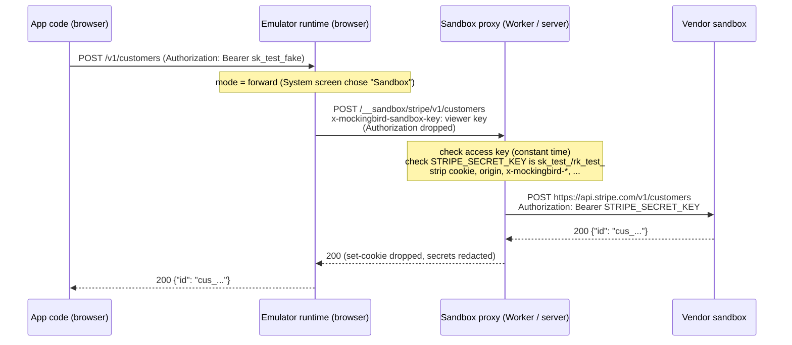

# @crvouga/mockingbird-preview

> Local emulators. Real API contracts. Part of [Mockingbird](https://github.com/crvouga-organization/mockingbird).

Reusable infrastructure for static application previews: a streaming Fetch bridge over MessagePort,
shared worker lifecycle, verified compressed assets, a Node test adapter, and Cloudflare named
Worker Preview deployment. App entrypoints, schemas, synthetic fixtures, credentials acquisition,
cloud identities and organization CI policy remain in the consuming application.

## Install

```sh
npm install @crvouga/mockingbird-preview
```

## Usage

A module worker creates its application once, and attaches each visiting page to that same system:

```ts
import { createPreviewHost, installPreviewWorkerHost } from "@crvouga/mockingbird-preview"

const host = createPreviewHost({
  artifact: "sha256:the-build-identity",
  boot: async ({ generation, signal }) => ({
    fetch: (request) => Response.json({ generation, path: new URL(request.url).pathname }),
    dispose: async () => {},
  }),
  allow: (url) => url.hostname === "app.preview",
})

installPreviewWorkerHost(host, self)
```

The page uses `connectSharedPreviewWorker("/worker.js", { application: "demo", artifact:
"sha256:the-build-identity", generation: 0 })` and its returned `fetch`. The browser's normal
same-origin restrictions apply to the worker URL. Each connected page has isolated in-flight
requests. Disconnecting a page does not dispose the shared system. Call `host.reset()` to abort
connections, dispose state and boot the next generation; reconnect clients afterwards. A failed
boot is visible through `status()` and returns HTTP 503. Calling `dispose()` terminates the host.
The application must honor the boot/request AbortSignals to terminate work it started.

## API

- `createPreviewClient(port, options)` exposes `fetch`, `dispose()` and the number of pending
  requests. `timeoutMs` covers response headers and the complete response stream (30 seconds by
  default); configure it for intentionally long-lived streams. Worker death without a port error
  is detected by this deadline. `allow(url)` optionally restricts destinations at the client.
- `servePreviewPort(port, fetch, options)` handles requests through the application's Fetch
  handler. Responses use transferable ArrayBuffers and one chunk per consumer pull; cancellation
  aborts the handler's signal and reader. Pre-header failures reject fetch and post-header failures
  error its body. Error messages are opaque to avoid leaking server details. `maxRequests`
  bounds concurrent requests per port, default 128. `onClose` supports connection accounting.
- `createPreviewHost({ artifact, boot, allow })` serializes boot/reset/dispose and exposes
  `connect`, `fetch`, `status`, `ready`, `reset` and `dispose`. It owns no emulator-specific state:
  use a fleet's lifecycle inside the boot/dispose callbacks.
- `sharedPreviewWorkerName({ application, artifact, generation })` creates an unambiguous worker
  identity; changing artifact or generation creates a distinct SharedWorker.
- `connectSharedPreviewWorker(url, options)` opens a module SharedWorker and connects its port.
  `connectDedicatedPreviewWorker(url, options)` uses a dedicated module Worker and transferred
  MessageChannel. Both expose `fetch`, `pending`, `worker` and `dispose`; worker errors reject
  pending requests. Dedicated disposal also terminates its worker.
- `installPreviewWorkerHost(host, scope)` accepts SharedWorker connection events and dedicated
  worker MessagePort handshakes. Returns an async disposer.
- `createPreviewArtifact(bytes, { commit, url, encoding })` records format version, source commit,
  exact packed byte count and SHA-256. `parsePreviewArtifact(value)` validates this manifest.
  `digestPreviewBytes(bytes)` returns a lowercase SHA-256 digest.
- `loadPreviewArtifact(manifest, options)` fetches with `no-store`, no credentials and redirect
  refusal; checks expected commit, size and hash before optional gzip decompression. Packed and
  decompressed sizes are bounded by `maximumBytes` (128 MiB default). The result is bytes; the
  caller deliberately chooses how to execute or persist trusted application code. It never evals
  arbitrary fetched source.
- `selectPreviewAction(currentFacts, builtCommit)` chooses deploy/remove/skip from current PR
  state. Closed PRs select removal; forks and stale build heads cannot deploy.
- `planPreviewSweep({ previews, openNames, owns, now, retentionMs, capacity })` is a pure plan
  listing managed names removed for orphaning, expiry or capacity. It never removes unmanaged
  names or performs cloud operations. Capacity eviction retains the newest managed previews.
- `createCloudflarePreviews({ accountId, workerName, token, fetch })` returns `deploy`, `list` and
  `remove`. `deploy` takes explicit static files, source commit, a name and a `currentPullRequest`
  callback. It checks current facts before upload and immediately before deployment, sends only
  missing assets, preserves optional `_headers` text and uses content identity to avoid repeating
  an already identical deployment. `list` follows pages and throws on API failures; `remove`
  treats HTTP 404 as success. No production Worker deployment is changed.
- `previewNodeHandler(fetch)` and `listenPreview(fetch, { port, hostname })`, from the `/node`
  export, expose the same Fetch handler or browser bridge to a Node HTTP test runner. The default
  listener is loopback on an ephemeral port. Responses are always `Cache-Control: no-store` to
  avoid browser worker-asset cache failures. Stream errors destroy the response instead of
  creating a successful EOF. Call the returned `close()` to release the listener.
- `createSandboxProxy({ providers, env, accessKey?, basePath?, allowOrigins?, fetch? })`, from the
  `/sandbox-proxy` export (also re-exported from the package root), is the sandbox proxy's Fetch
  handler; `sandboxProxyWorker(options)` wraps it as a Cloudflare Worker `{ fetch(request, env) }`.
  `sandboxProviders` holds the Stripe, Junction, Resend, Slack, Twilio and FCM providers;
  `SANDBOX_KEY_HEADER` names the access-key header and `safeEqual(a, b)` is the constant-time
  comparison it uses. See [Sandbox mode](#sandbox-mode).
- `createSandbox({ proxyUrl?, storage?, fetch? })` is the browser side: `upstream(id)` for an
  emulator's `createRuntime({ upstream })` and `controls(services)` for the System screen.
  `SANDBOX_MESSAGES` holds its status sentences and `SANDBOX_STORAGE_KEYS` its storage keys.

## Cookies, redirects and trust

The bridge defaults to removing Cookie and Set-Cookie headers. It does not borrow browser cookies
or impersonate the page origin. For a fully virtual application, both bridge ends may opt into
`cookies: true`; that carries explicitly supplied cookie headers, but supplies no cookie jar and
never writes `document.cookie`. The host must own a jar per intended user/session if needed.
Responses preserve redirect statuses and Location; redirects are always manual, including when a
Request uses its usual `follow` default. Follow redirects explicitly through the same allowlisted
Fetch boundary. Do not forward authorization/cookies to a new origin. These deliberate rules avoid
silently following an allowed virtual request into a real production host.

Request bodies are buffered before transfer; response bodies stream with backpressure. This is
not a streaming request-upload implementation. Ports are trusted capabilities, not an untrusted
RPC/authentication boundary. Browser-delivered code, environment values and files remain visible
and editable by the visitor. Never put production or shared secret values in these artifacts.

Cloudflare helpers require an existing parent Worker and explicit account credentials on the
trusted CI/server side. They create named Preview resources with base-config inheritance disabled,
no environment bindings, and assets-only deployments. Existing organization ownership/naming
rules remain the caller's responsibility. Per-PR deployment jobs must be serialized externally:
the final head re-read narrows, but cannot eliminate, races without a provider compare-and-swap.
A retry after an ambiguous create response should re-read the named preview before retrying.
No live cloud credentials were used for the package's acceptance tests.

Cloudflare protocol references:
[official Preview API implementation](https://github.com/cloudflare/workers-sdk/blob/main/packages/deploy-helpers/src/preview/api.ts),
[asset upload documentation](https://developers.cloudflare.com/workers/static-assets/direct-upload/),
[Worker Previews](https://developers.cloudflare.com/workers/previews/).

## Sandbox mode

A preview runs every third-party service as an in-browser emulator. Sandbox mode lets a viewer
flip one service at a time from **Emulated** to **Sandbox**: that emulator's runtime switches to
forward mode (`PUT /__admin/upstream {"mode":"forward"}`) and sends the app's API calls to the
vendor's real sandbox or test account. The browser never holds a vendor secret. A small Fetch
handler, the **sandbox proxy** (`@crvouga/mockingbird-preview/sandbox-proxy`), sits next to the
static preview, holds the secrets in its environment and attaches them per request.



### Providers

`sandboxProviders` holds the vendors the proxy knows; pass the ones you want to offer.

| id | Sandbox host | Env secrets | Live-key guard | Notes and limitations |
| --- | --- | --- | --- | --- |
| `stripe` | `api.stripe.com` | `STRIPE_SECRET_KEY` | must start `sk_test_` or `rk_test_` | Only `/v1/*`. Prices, products, coupons and webhook endpoints the app names must exist in the test account. |
| `junction` | `api.sandbox.tryvital.io` (`api.sandbox.eu.tryvital.io` for `sk_eu_` keys) | `JUNCTION_API_KEY` | must start `sk_us_` or `sk_eu_` | Only `/v<n>/*`, sent as `x-vital-api-key`. Lab test ids and users must exist in the sandbox team. |
| `resend` | `api.resend.com` | `RESEND_API_KEY` | none (Resend keys have no test prefix) | Real email is sent: use a sending domain and recipients you own. |
| `slack` | `slack.com` | `SLACK_BOT_TOKEN` | none | Only `/api/*`. Channels and users must exist in the workspace the bot is in. |
| `twilio` | `api.twilio.com`, `verify.twilio.com`, `lookups.twilio.com`, `messaging.twilio.com` (by path) | `TWILIO_ACCOUNT_SID`, `TWILIO_AUTH_TOKEN` | none (use test credentials or a trial account) | Any `/Accounts/<sid>/` is rewritten to the real SID. Sender numbers, Messaging Service SIDs and Verify Service SIDs must exist in that account. `/v1/Services` always goes to Messaging, so Conversations' `/v1/Services` is ambiguous and not reachable. |
| `fcm` | `fcm.googleapis.com` | `FCM_ACCESS_TOKEN`, `FCM_PROJECT_ID` | none | Only `POST /v1/projects/*/messages:send`; the project id is rewritten to `FCM_PROJECT_ID`. The access token is a short-lived OAuth token (about an hour): refresh it out of band. |

For every provider: vendor webhooks are **not** relayed back to the browser emulator, and
forwarded responses are relayed as-is (emulators with a forwarded-response hook, such as Resend,
FCM and Twilio, record a receipt; Stripe and Junction do not mirror sandbox objects into their
state). A path a provider does not map answers `501`.

### Security model

- **Fails closed.** Without `SANDBOX_PROXY_TOKEN` (or the env name passed as `accessKey`) the
  manifest reports `access: "disabled"` and every relay answers `503`. A caller must send that
  value in `x-mockingbird-sandbox-key`; it is compared in constant time, and a wrong or missing
  key gets `401`. Only a caller with the key learns which providers are configured.
- **Allowlisted hosts only.** Each provider builds the vendor URL on a fixed origin from the
  path; a crafted path cannot change the host, and unmapped paths answer `501`. Redirects are
  returned, never followed.
- **Secrets never reach the browser.** The proxy drops the caller's `authorization`, `cookie`,
  `origin`, `referer`, `x-mockingbird-*`, `cf-*`, `x-forwarded-*` and `forwarded` headers,
  attaches the credential itself, drops `set-cookie` from the answer, and redacts every secret
  value from its own errors and from text responses (account identifiers such as the Twilio
  Account SID stay). Errors are `{ "error": { "code", "message" } }`.
- **A live key is refused.** `check` rejects Stripe live keys and Junction production keys before
  anything is sent (`503`, and the System screen shows why).
- **Access key per viewer.** The browser keeps the access key and chosen modes in its own
  `localStorage`; share the key only with people who may spend the sandbox accounts. CORS is off
  unless `allowOrigins` lists the page's origin; mounting the proxy on the page's own origin (as
  below) needs none.

### Mounting the proxy

A Cloudflare Worker that serves the static preview and the proxy on one origin (set the secrets
with `wrangler secret put SANDBOX_PROXY_TOKEN`, `wrangler secret put STRIPE_SECRET_KEY`, ...):

```ts
import { sandboxProviders, sandboxProxyWorker } from "@crvouga/mockingbird-preview/sandbox-proxy"

const proxy = sandboxProxyWorker({
  basePath: "/__sandbox",
  providers: Object.values(sandboxProviders),
})

export default {
  fetch(request: Request, env: Record<string, string | undefined> & { ASSETS: { fetch(request: Request): Promise<Response> } }) {
    const { pathname } = new URL(request.url)
    if (pathname === "/__sandbox" || pathname.startsWith("/__sandbox/")) {
      const { ASSETS: _assets, ...secrets } = env
      return proxy.fetch(request, secrets)
    }
    return env.ASSETS.fetch(request)
  },
}
```

A Bun server (Node 18+ and Deno work the same with any Fetch-handler server), secrets from
`.env.local` / the process environment:

```ts
import { createSandboxProxy, sandboxProviders } from "@crvouga/mockingbird-preview/sandbox-proxy"

const sandbox = createSandboxProxy({
  basePath: "/__sandbox",
  providers: [sandboxProviders.stripe, sandboxProviders.resend],
  env: process.env,
  allowOrigins: ["http://localhost:5173"], // only when the page is on another origin
})

Bun.serve({
  port: 8787,
  fetch: (request) =>
    new URL(request.url).pathname.startsWith("/__sandbox")
      ? sandbox(request)
      : new Response("Not found", { status: 404 }),
})
```

`GET /__sandbox/` answers the manifest:
`{ access: "granted" | "denied" | "disabled", providers: [{ id, label, configured, missing, error? }] }`.

### Browser wiring

```ts
import { createSandbox } from "@crvouga/mockingbird-preview"
import { createRuntime as createStripe } from "@crvouga/mockingbird-service-stripe"
import { createRuntime as createResend } from "@crvouga/mockingbird-service-resend"

const sandbox = createSandbox({ proxyUrl: "/__sandbox" }) // omit proxyUrl: sandbox not offered

// Each emulator forwards through the proxy when switched to Sandbox; it boots emulated.
const stripe = createStripe({ upstream: sandbox.upstream("stripe") })
const resend = createResend({ upstream: sandbox.upstream("resend") })

// The System screen's service list (`mountSystemHarness(host, surfaces, { services })`).
const services = sandbox.controls([
  { id: "stripe", label: "Stripe", category: "Payments", admin: (r) => stripe.fetch(r) },
  { id: "resend", label: "Resend", category: "Email", admin: (r) => resend.fetch(r) },
  {
    id: "keycloak",
    label: "Keycloak",
    admin: async () => Response.json({ mode: "emulated" }),
    unsupported: "Runs in this browser; there is no vendor sandbox",
  },
])

await services.setAccessKey("the key the proxy's SANDBOX_PROXY_TOKEN holds")
await services.setMode("stripe", "sandbox") // throws a readable reason when unavailable
const { sandbox: status, services: rows } = await services.list()
```

`upstream(id)` gives `{ baseUrl: "<proxy>/<id>", fetch, rewriteAuth }`: `fetch` adds the stored
access key, `rewriteAuth` drops the app's fake `authorization`. `controls()` reads each
emulator's mode from `GET /__admin/upstream`, and its `unavailable` reason follows this order:
the spec's `unsupported`, no proxy configured, proxy unreachable, proxy without
`SANDBOX_PROXY_TOKEN`, access key missing or wrong, provider secrets missing, the provider's
`check` error. Chosen modes persist per viewer; because emulator state resets on reload, the first
`list()` re-applies stored Sandbox choices that are still available.

## Validation

Tests exercise concurrent requests, first-chunk delivery, cancellation, deadlines, failures on
both sides of response headers, target restrictions, two virtual apps sharing a real Chromium
SharedWorker, reset/disconnect, compressed integrity/size limits, the Node HTTP adapter, and injected
Cloudflare upload/pagination/stale-head/deletion failures. Cloudflare behavior is based on official
API source and documentation, not a live-account parity claim.

## Runtime compatibility

`@crvouga/mockingbird-runtime/preview/*` delegates to this package, preserving its legacy signatures.
`loadPreviewArtifact` also accepts `LegacyPreviewArtifact` (`version: 1`, `sha256`, `url`, optional
`compression: "gzip"`), whose hash covers decoded bytes. Legacy downloads still enforce the same
bounded loading, no-store and redirect policy; they cannot satisfy `expectedCommit` because they
carry no commit. New manifests cover packed bytes, size and source commit.

The bridge's `exposeErrors: true` option on both ends exists for trusted legacy compatibility.
It forwards original error messages and must not be enabled on a boundary that needs opaque
errors. Both ends must also opt into `cookies: true` to transport explicit virtual cookie headers.
These options do not create a browser cookie jar or expose server-held credentials.
