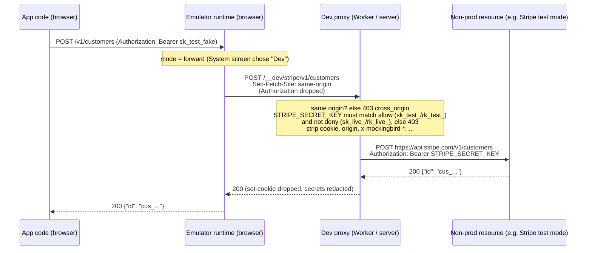
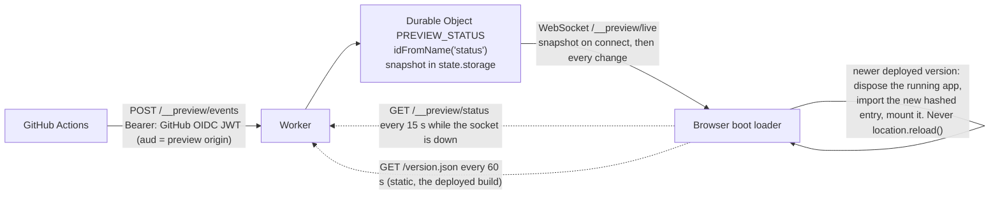

# @crvouga/mockingbird-preview

> Local emulators. Real API contracts. Part of [Mockingbird](https://github.com/crvouga-organization/mockingbird).

Reusable infrastructure for static application previews: a streaming Fetch bridge over MessagePort,
shared worker lifecycle, verified compressed assets, a Node test adapter, and Cloudflare named
Worker Preview deployment. App entrypoints, schemas, synthetic fixtures, credentials acquisition,
cloud identities and organization CI policy remain in the consuming application.

## Install

```sh
npm install @crvouga/mockingbird-preview
```

## Usage

A module worker creates its application once, and attaches each visiting page to that same system:

```ts
import { createPreviewHost, installPreviewWorkerHost } from "@crvouga/mockingbird-preview"

const host = createPreviewHost({
  artifact: "sha256:the-build-identity",
  boot: async ({ generation, signal }) => ({
    fetch: (request) => Response.json({ generation, path: new URL(request.url).pathname }),
    dispose: async () => {},
  }),
  allow: (url) => url.hostname === "app.preview",
})

installPreviewWorkerHost(host, self)
```

The page uses `connectSharedPreviewWorker("/worker.js", { application: "demo", artifact:
"sha256:the-build-identity", generation: 0 })` and its returned `fetch`. The browser's normal
same-origin restrictions apply to the worker URL. Each connected page has isolated in-flight
requests. Disconnecting a page does not dispose the shared system. Call `host.reset()` to abort
connections, dispose state and boot the next generation; reconnect clients afterwards. A failed
boot is visible through `status()` and returns HTTP 503. Calling `dispose()` terminates the host.
The application must honor the boot/request AbortSignals to terminate work it started.

## API

- `createPreviewClient(port, options)` exposes `fetch`, `dispose()` and the number of pending
  requests. `timeoutMs` covers response headers and the complete response stream (30 seconds by
  default); configure it for intentionally long-lived streams. Worker death without a port error
  is detected by this deadline. `allow(url)` optionally restricts destinations at the client.
- `servePreviewPort(port, fetch, options)` handles requests through the application's Fetch
  handler. Responses use transferable ArrayBuffers and one chunk per consumer pull; cancellation
  aborts the handler's signal and reader. Pre-header failures reject fetch and post-header failures
  error its body. Error messages are opaque to avoid leaking server details. `maxRequests`
  bounds concurrent requests per port, default 128. `onClose` supports connection accounting.
- `createPreviewHost({ artifact, boot, allow })` serializes boot/reset/dispose and exposes
  `connect`, `fetch`, `status`, `ready`, `reset` and `dispose`. It owns no emulator-specific state:
  use a fleet's lifecycle inside the boot/dispose callbacks.
- `sharedPreviewWorkerName({ application, artifact, generation })` creates an unambiguous worker
  identity; changing artifact or generation creates a distinct SharedWorker.
- `connectSharedPreviewWorker(url, options)` opens a module SharedWorker and connects its port.
  `connectDedicatedPreviewWorker(url, options)` uses a dedicated module Worker and transferred
  MessageChannel. Both expose `fetch`, `pending`, `worker` and `dispose`; worker errors reject
  pending requests. Dedicated disposal also terminates its worker.
- `installPreviewWorkerHost(host, scope)` accepts SharedWorker connection events and dedicated
  worker MessagePort handshakes. Returns an async disposer.
- `createPreviewArtifact(bytes, { commit, url, encoding })` records format version, source commit,
  exact packed byte count and SHA-256. `parsePreviewArtifact(value)` validates this manifest.
  `digestPreviewBytes(bytes)` returns a lowercase SHA-256 digest.
- `loadPreviewArtifact(manifest, options)` fetches with `no-store`, no credentials and redirect
  refusal; checks expected commit, size and hash before optional gzip decompression. Packed and
  decompressed sizes are bounded by `maximumBytes` (128 MiB default). The result is bytes; the
  caller deliberately chooses how to execute or persist trusted application code. It never evals
  arbitrary fetched source.
- `selectPreviewAction(currentFacts, builtCommit)` chooses deploy/remove/skip from current PR
  state. Closed PRs select removal; forks and stale build heads cannot deploy.
- `planPreviewSweep({ previews, openNames, owns, now, retentionMs, capacity })` is a pure plan
  listing managed names removed for orphaning, expiry or capacity. It never removes unmanaged
  names or performs cloud operations. Capacity eviction retains the newest managed previews.
- `createCloudflarePreviews({ accountId, workerName, token, fetch })` returns `deploy`, `list` and
  `remove`. `deploy` takes explicit static files, source commit, a name and a `currentPullRequest`
  callback. It checks current facts before upload and immediately before deployment, sends only
  missing assets, preserves optional `_headers` text and uses content identity to avoid repeating
  an already identical deployment. `list` follows pages and throws on API failures; `remove`
  treats HTTP 404 as success. No production Worker deployment is changed.
- `previewNodeHandler(fetch)` and `listenPreview(fetch, { port, hostname })`, from the `/node`
  export, expose the same Fetch handler or browser bridge to a Node HTTP test runner. The default
  listener is loopback on an ephemeral port. Responses are always `Cache-Control: no-store` to
  avoid browser worker-asset cache failures. Stream errors destroy the response instead of
  creating a successful EOF. Call the returned `close()` to release the listener.
- `createDevProxy({ providers, env, allow, basePath?, allowOrigins?, trustNonBrowser?, fetch? })`, from
  the `/dev-proxy` export (also re-exported from the package root), is the dev proxy's Fetch
  handler; `devProxyWorker(options)` wraps it as a Cloudflare Worker `{ fetch(request, env) }`.
  `allow` is required: an anchored pattern per env value a provider reads, checked default-deny.
  `devProviders` holds the Stripe, Junction, Resend, Slack, Twilio and FCM providers;
  `NON_PROD_PATTERNS` the vendor formats that by themselves prove a non-production credential;
  and `devBaseUrlName(id)` the `<ID>_BASE_URL` override name. See [Dev resources](#dev-resources).
- `createDevResources({ proxyUrl?, storage?, fetch? })` is the browser side: `upstream(id)` for an
  emulator's `createRuntime({ upstream })` and `controls(services)` for the System screen.
  `DEV_MESSAGES` holds its status sentences and `DEV_STORAGE_KEYS` its storage keys.
- `createPreviewStatusObject({ verify, pr?, upgrade? })`, from the `/preview-status` export (also
  re-exported from the package root), returns a Durable Object class holding a preview's CI status
  snapshot: `GET /status`, `GET /live` (hibernatable WebSocket: the snapshot on connect and on every
  change, `ping` answered with `pong`) and `POST /events`. `previewStatusRoutes({ basePath?,
  binding? })` forwards `/__preview/status|live|events` from the Worker to it (same-origin only for
  status and live). `githubOidcVerifier({ repository, audience?, issuer?, fetch?, now? })` verifies
  the GitHub Actions OIDC token CI posts events with, and `parsePreviewEvent(value)` validates an
  event body. See [Live previews](#live-previews).
- `createLivePreview({ current, load, basePath?, versionUrl?, countdownMs?, storage?, … })` is the
  browser side: it mounts `current`, follows the status object, and swaps in each newly deployed
  build without reloading the page. Its result is structurally the UI package's `SystemBuild`
  (pass it to `mountSystemHarness(…, { build })`) plus `start()` and `close()`.
  `isChunkLoadFailure(event)` recognizes a lazy chunk that failed to load, and
  `LIVE_PREVIEW_STORAGE_KEY` is where the auto-update preference persists.

## Cookies, redirects and trust

The bridge defaults to removing Cookie and Set-Cookie headers. It does not borrow browser cookies
or impersonate the page origin. For a fully virtual application, both bridge ends may opt into
`cookies: true`; that carries explicitly supplied cookie headers, but supplies no cookie jar and
never writes `document.cookie`. The host must own a jar per intended user/session if needed.
Responses preserve redirect statuses and Location; redirects are always manual, including when a
Request uses its usual `follow` default. Follow redirects explicitly through the same allowlisted
Fetch boundary. Do not forward authorization/cookies to a new origin. These deliberate rules avoid
silently following an allowed virtual request into a real production host.

Request bodies are buffered before transfer; response bodies stream with backpressure. This is
not a streaming request-upload implementation. Ports are trusted capabilities, not an untrusted
RPC/authentication boundary. Browser-delivered code, environment values and files remain visible
and editable by the visitor. Never put production or shared secret values in these artifacts.

Cloudflare helpers require an existing parent Worker and explicit account credentials on the
trusted CI/server side. They create named Preview resources with base-config inheritance disabled,
no environment bindings, and assets-only deployments. Existing organization ownership/naming
rules remain the caller's responsibility. Per-PR deployment jobs must be serialized externally:
the final head re-read narrows, but cannot eliminate, races without a provider compare-and-swap.
A retry after an ambiguous create response should re-read the named preview before retrying.
No live cloud credentials were used for the package's acceptance tests.

Cloudflare protocol references:
[official Preview API implementation](https://github.com/cloudflare/workers-sdk/blob/main/packages/deploy-helpers/src/preview/api.ts),
[asset upload documentation](https://developers.cloudflare.com/workers/static-assets/direct-upload/),
[Worker Previews](https://developers.cloudflare.com/workers/previews/).

## Dev resources

A preview runs every third-party service as an in-browser emulator. Dev resources let a viewer
flip one service at a time from **Emulated** to **Dev**: that emulator's runtime switches to
forward mode (`PUT /__admin/upstream {"mode":"forward"}`) and sends the app's API calls to a real
**non-production** resource the app's dev instance uses: a Stripe account in test mode,
Junction's sandbox, a dev Resend account, a dev Slack workspace, a self-hosted dev instance. The
browser never holds a credential. A small Fetch handler, the **dev proxy**
(`@crvouga/mockingbird-preview/dev-proxy`), sits next to the static preview, holds the secrets in
its environment and attaches them per request, and only after checking that every one of them is
allowed. It is mounted on the dev app's own origin and trusts that app: there is no access key,
and the client never handles a credential.



### Safety model: default deny

Nothing is reachable until you say, in code, what a non-production value looks like.

- **`allow` is required.** For every env value a provider reads (its secrets, its identifiers and
  any `<ID>_BASE_URL` override) `allow` names the pattern it must match. A provider with an env
  value that has no entry, or does not match it, is **blocked**: the manifest reports why and
  every relay answers `403 { "error": { "code": "not_allowed", "message" } }` without sending
  anything. Patterns must be anchored (`/^…$/`, no `m` flag) or `createDevProxy()` /
  `devProxyWorker()` throws; each is matched against the whole value. They live in code so they
  are reviewed, never in the environment.
- **Known production formats always lose.** A provider can declare `deny` patterns that win over
  `allow`: Stripe refuses `sk_live_` and `rk_live_` keys even under `allow: { STRIPE_SECRET_KEY: /^.+$/ }`.
- **`NON_PROD_PATTERNS`** holds the vendor formats that by themselves prove a non-production
  credential (`STRIPE_SECRET_KEY: /^(sk|rk)_test_[A-Za-z0-9]+$/`,
  `JUNCTION_API_KEY: /^sk_(us|eu)_[A-Za-z0-9_-]+$/`). Resend, Slack, Twilio and FCM credentials
  look the same in production and development, so there is no entry for them: pin an identifier
  (`TWILIO_ACCOUNT_SID: /^AC0123…$/`, `FCM_PROJECT_ID: /^my-app-dev$/`) or write a pattern that
  only your dev credential matches.
- **Reasons never echo values.** `blocked` reads "No allow-list pattern for RESEND_API_KEY",
  "STRIPE_SECRET_KEY does not match its allow-list pattern" or "STRIPE_SECRET_KEY is a production
  credential"; the System screen shows it as the service's reason.
- **Base URL overrides are allow-listed too.** Each provider has a default host. An env value
  `<ID>_BASE_URL` (`RESEND_BASE_URL`, `JUNCTION_BASE_URL`, ...; `devBaseUrlName(id)`) replaces it
  only when `allow` has a matching entry for that name and the value is an `https:` URL without
  query or credentials; a path prefix is kept. Otherwise the provider is blocked. This is how a
  self-hosted dev instance is reached.

| id | Reaches by default | Secrets | Identifiers | `allow` entry |
| --- | --- | --- | --- | --- |
| `stripe` | `api.stripe.com` (`/v1/*`) | `STRIPE_SECRET_KEY` | | `NON_PROD_PATTERNS` (test-mode keys; live keys are denied) |
| `junction` | Junction's sandbox `api.sandbox.tryvital.io` (`api.sandbox.eu.tryvital.io` for `sk_eu_` keys; `/v<n>/*`) | `JUNCTION_API_KEY` | | `NON_PROD_PATTERNS` |
| `resend` | `api.resend.com` | `RESEND_API_KEY` | | pin your dev key, or reach a dev instance via `RESEND_BASE_URL` |
| `slack` | `slack.com` (`/api/*`) | `SLACK_BOT_TOKEN` | | pin your dev workspace's bot token |
| `twilio` | `api.twilio.com`, `verify.twilio.com`, `lookups.twilio.com`, `messaging.twilio.com` (by path) | `TWILIO_ACCOUNT_SID`, `TWILIO_AUTH_TOKEN` | `TWILIO_ACCOUNT_SID` | pin an identifier: `TWILIO_ACCOUNT_SID` (test credentials or a dev subaccount) |
| `fcm` | `fcm.googleapis.com` (`POST /v1/projects/*/messages:send`) | `FCM_ACCESS_TOKEN`, `FCM_PROJECT_ID` | `FCM_PROJECT_ID` | pin an identifier: `FCM_PROJECT_ID` (your dev project) |

Every value in the Secrets column needs an `allow` entry, including the token next to a pinned
identifier (a loose `/^.+$/` is fine there: the pin is what proves non-prod).

Provider notes: Stripe prices, products, coupons and webhook endpoints the app names must exist in
the test-mode account. Junction lab test ids and users must exist in Junction's sandbox team; a
`JUNCTION_BASE_URL` override replaces the EU host switch. Resend really sends email: use a sending
domain and recipients you own. Slack channels and users must exist in the bot's workspace. Twilio
rewrites any `/Accounts/<sid>/` to the configured SID; sender numbers and Messaging / Verify
Service SIDs must exist in that account; `/v1/Services` always goes to Messaging, so Conversations'
`/v1/Services` is not reachable; a `TWILIO_BASE_URL` override replaces only the default API host
(`/2010-04-01/*`), Verify, Lookups and Messaging keep their vendor hosts. FCM rewrites the project
id to `FCM_PROJECT_ID`; the access token is a short-lived OAuth token (about an hour), refresh it
out of band.

For every provider: vendor webhooks are **not** relayed back to the browser emulator, and
forwarded responses are relayed as-is (emulators with a forwarded-response hook, such as Resend,
FCM and Twilio, record a receipt; Stripe and Junction do not mirror remote objects into their
state). A path a provider does not map answers `501`.

### Trust and transport

- **Same-origin only.** The proxy answers a request only when the browser marks it
  `Sec-Fetch-Site: same-origin` and its `Origin`, when sent, is the proxy's own origin (or listed
  in `allowOrigins`, which also turns on CORS for exactly those origins). Cross-site, same-site and
  navigation requests, and a foreign `Origin`, get `403 { "error": { "code": "cross_origin" } }`
  with nothing sent. A request without `Sec-Fetch-Site` (curl, a server, a test) is refused too
  unless the proxy is built with `trustNonBrowser: true`.
- **Who can open the preview is the preview host's job.** Anyone who can load the page can use its
  dev resources, so restrict the preview itself, e.g. with
  [Cloudflare Access](https://developers.cloudflare.com/cloudflare-one/policies/access/) in front
  of the Worker. The allow-list above is what keeps those resources non-production.
- **Fixed hosts only.** Each provider builds the URL on its fixed (or allow-listed override)
  base from the path; a crafted path cannot change the host, and unmapped paths answer `501`.
  Redirects are returned, never followed.
- **Secrets never reach the browser.** The proxy drops the caller's `authorization`, `cookie`,
  `origin`, `referer`, `x-mockingbird-*`, `cf-*`, `x-forwarded-*` and `forwarded` headers,
  attaches the credential itself, drops `set-cookie` from the answer, and redacts every secret
  value from its own errors and from text responses (account identifiers such as the Twilio
  Account SID stay). Errors are `{ "error": { "code", "message" } }`.
- **Modes per viewer.** The browser keeps only the chosen modes in its own `localStorage`.

### Mounting the proxy

A Cloudflare Worker that serves the static preview and the proxy on one origin (set the secrets
with `wrangler secret put STRIPE_SECRET_KEY`, ...):

```ts
import {
  devProviders,
  devProxyWorker,
  NON_PROD_PATTERNS,
} from "@crvouga/mockingbird-preview/dev-proxy"

const proxy = devProxyWorker({
  basePath: "/__dev",
  providers: [devProviders.stripe, devProviders.junction, devProviders.twilio],
  allow: {
    ...NON_PROD_PATTERNS,
    TWILIO_ACCOUNT_SID: /^AC_YOUR_DEV_ACCOUNT_SID$/, // the dev account, pinned
    TWILIO_AUTH_TOKEN: /^[0-9a-f]{32}$/,
  },
})

export default {
  fetch(request: Request, env: Record<string, string | undefined> & { ASSETS: { fetch(request: Request): Promise<Response> } }) {
    const { pathname } = new URL(request.url)
    if (pathname === "/__dev" || pathname.startsWith("/__dev/")) {
      const { ASSETS: _assets, ...secrets } = env
      return proxy.fetch(request, secrets)
    }
    return env.ASSETS.fetch(request)
  },
}
```

A Bun server (Node 18+ and Deno work the same with any Fetch-handler server), secrets from
`.env.local` / the process environment, reaching a self-hosted dev Resend-compatible instance:

```ts
import { createDevProxy, devProviders, NON_PROD_PATTERNS } from "@crvouga/mockingbird-preview/dev-proxy"

const dev = createDevProxy({
  basePath: "/__dev",
  providers: [devProviders.stripe, devProviders.resend],
  env: process.env,
  allow: {
    ...NON_PROD_PATTERNS,
    RESEND_API_KEY: /^re_dev_[A-Za-z0-9_]+$/,
    RESEND_BASE_URL: /^https:\/\/mail\.dev\.example\.com$/,
  },
  allowOrigins: ["http://localhost:5173"], // only when the page is served from another origin
})

Bun.serve({
  port: 8787,
  fetch: (request) =>
    new URL(request.url).pathname.startsWith("/__dev")
      ? dev(request)
      : new Response("Not found", { status: 404 }),
})
```

`GET /__dev/` answers the manifest:
`{ providers: [{ id, label, configured, missing, blocked? }] }`.

### Browser wiring

```ts
import { createDevResources } from "@crvouga/mockingbird-preview"
import { createRuntime as createStripe } from "@crvouga/mockingbird-service-stripe"
import { createRuntime as createResend } from "@crvouga/mockingbird-service-resend"

const dev = createDevResources({ proxyUrl: "/__dev" }) // omit proxyUrl: dev resources not offered

// Each emulator forwards through the proxy when switched to Dev; it boots emulated.
const stripe = createStripe({ upstream: dev.upstream("stripe") })
const resend = createResend({ upstream: dev.upstream("resend") })

// The System screen's service list (`mountSystemHarness(host, surfaces, { services })`).
const services = dev.controls([
  { id: "stripe", label: "Stripe", category: "Payments", admin: (r) => stripe.fetch(r) },
  { id: "resend", label: "Resend", category: "Email", admin: (r) => resend.fetch(r) },
  {
    id: "keycloak",
    label: "Keycloak",
    admin: async () => Response.json({ mode: "emulated" }),
    unsupported: "Runs in this browser; there is no remote dev resource",
  },
])

await services.setMode("stripe", "dev") // throws a readable reason when unavailable
const { dev: status, services: rows } = await services.list()
```

`upstream(id)` gives `{ baseUrl: "<proxy>/<id>", fetch, rewriteAuth }`: `fetch` sends the request
to the proxy as-is (the browser adds `Sec-Fetch-Site`), `rewriteAuth` drops the app's fake
`authorization` and any cookie. `controls()` reads each
emulator's mode from `GET /__admin/upstream`, and its `unavailable` reason follows this order:
the spec's `unsupported`, no proxy configured, proxy unreachable or refusing the page
(`cross_origin`), provider secrets missing, the provider's `blocked` reason. Chosen modes persist per viewer; because emulator state resets on reload, the
first `list()` re-applies stored Dev choices that are still available.

## Live previews

A PR preview that knows what CI is doing to it and moves itself to every new deploy, with no hard
refresh: the open tab shows when a newer commit is building, deployed or failed, the PR's checks,
and how fresh it is, then swaps in the new build in place.



Events are `{ kind: "build", state: "building" | "deployed" | "failed", version, at, runUrl?,
message? }` and `{ kind: "checks", state: "running" | "passed" | "failed", version, at, runUrl?,
summary? }` (`version` is the commit SHA, `at` an ISO time). An event older than the stored one of
the same kind and version is ignored, so retried or reordered CI steps cannot move the status back.

### Worker wiring

```ts
import {
  createPreviewStatusObject,
  githubOidcVerifier,
  previewStatusRoutes,
} from "@crvouga/mockingbird-preview/preview-status"

export const PreviewStatus = createPreviewStatusObject({
  verify: githubOidcVerifier({ repository: "owner/name" }), // aud defaults to the request origin
  pr: (env) =>
    typeof env.PR_NUMBER === "string"
      ? { number: Number(env.PR_NUMBER), url: `https://github.com/owner/name/pull/${env.PR_NUMBER}` }
      : undefined,
})

const status = previewStatusRoutes() // "/__preview", binding "PREVIEW_STATUS"

export default {
  fetch: (request: Request, env: Record<string, unknown> & { ASSETS: { fetch(request: Request): Promise<Response> } }) =>
    status(request, env) ?? env.ASSETS.fetch(request),
}
```

```jsonc
// wrangler.jsonc
"durable_objects": { "bindings": [{ "name": "PREVIEW_STATUS", "class_name": "PreviewStatus" }] },
"migrations": [{ "tag": "v1", "new_sqlite_classes": ["PreviewStatus"] }]
```

The verifier accepts only RS256 tokens from `https://token.actions.githubusercontent.com` whose
`aud` is the preview's origin and whose `repository` claim matches, with 60 s of clock skew. Keys
come from the issuer's JWKS, cached ten minutes and refetched (at most every 30 s) when a token
names an unknown key. Failures answer 401 with a reason and never echo the token. There is no
shared secret to store.

### CI event step

Give the job `permissions: { id-token: write }`, request a token for the preview's origin and post
the event. Keep it best-effort: a status update must never fail CI.

```yaml
- name: Report build to the preview
  if: always()
  continue-on-error: true
  env:
    ORIGIN: https://my-app-pr-12.example.workers.dev
    STATE: ${{ job.status == 'success' && 'deployed' || 'failed' }}
  run: |
    token=$(curl -sf -H "Authorization: bearer $ACTIONS_ID_TOKEN_REQUEST_TOKEN" \
      "$ACTIONS_ID_TOKEN_REQUEST_URL&audience=$ORIGIN" | jq -r .value)
    jq -n --arg state "$STATE" --arg version "$GITHUB_SHA" \
      --arg at "$(date -u +%Y-%m-%dT%H:%M:%SZ)" \
      --arg runUrl "$GITHUB_SERVER_URL/$GITHUB_REPOSITORY/actions/runs/$GITHUB_RUN_ID" \
      '{kind: "build", state: $state, version: $version, at: $at, runUrl: $runUrl}' |
      curl -sf -X POST "$ORIGIN/__preview/events" -H "Authorization: Bearer $token" \
        -H "content-type: application/json" --data @- || true
```

### Browser boot loader

The build emits hashed entries plus a static `/version.json` (`{ version, builtAt, entry }`); the
page loads a small, stable boot script that never changes name:

```ts
import { createLivePreview, type PreviewVersion } from "@crvouga/mockingbird-preview"

const current = (await (await fetch("/version.json", { cache: "no-store" })).json()) as PreviewVersion
const host = document.getElementById("app") as HTMLElement

const live = createLivePreview({
  current,
  storage: localStorage,
  // Import the version's hashed entry and mount it; return its disposer.
  load: async (version) => {
    const app = (await import(version.entry)) as {
      start(host: HTMLElement, options: { build: typeof live }): Promise<() => void>
    }
    return app.start(host, { build: live })
  },
})
await live.start()
```

`start()` mounts `current`, then connects: WebSocket with backoff (1 s to 30 s, jittered) and a
`ping` every 25 s; `/status` polled every 15 s while the socket is down (`connection: "polling"`);
`/version.json` polled every 60 s regardless (`"offline"` when both fail); an immediate check when
the tab becomes visible. An update is offered only once `/version.json` names the new build, so its
assets are live. With auto-update on (the default, persisted per viewer) it applies after
`countdownMs` (10 s), or at once while the tab is hidden; `postpone()` skips the countdown until
the next new version. `applyUpdate()` disposes the running app and loads the new one; if that
fails it remounts the previous build and reports `update.error` (no automatic retry of that
version). A lazy chunk that fails to load (`Failed to fetch dynamically imported module`,
`ChunkLoadError`, …) means the tab's build was replaced: the client checks `/version.json` and
applies the new build at once. If the first mount fails, `start()` still connects and then
rejects, so a fixed build replaces the broken one as soon as it deploys.

## Validation

Tests exercise concurrent requests, first-chunk delivery, cancellation, deadlines, failures on
both sides of response headers, target restrictions, two virtual apps sharing a real Chromium
SharedWorker, reset/disconnect, compressed integrity/size limits, the Node HTTP adapter, and injected
Cloudflare upload/pagination/stale-head/deletion failures. Cloudflare behavior is based on official
API source and documentation, not a live-account parity claim.

## Runtime compatibility

`@crvouga/mockingbird-runtime/preview/*` delegates to this package, preserving its legacy signatures.
`loadPreviewArtifact` also accepts `LegacyPreviewArtifact` (`version: 1`, `sha256`, `url`, optional
`compression: "gzip"`), whose hash covers decoded bytes. Legacy downloads still enforce the same
bounded loading, no-store and redirect policy; they cannot satisfy `expectedCommit` because they
carry no commit. New manifests cover packed bytes, size and source commit.

The bridge's `exposeErrors: true` option on both ends exists for trusted legacy compatibility.
It forwards original error messages and must not be enabled on a boundary that needs opaque
errors. Both ends must also opt into `cookies: true` to transport explicit virtual cookie headers.
These options do not create a browser cookie jar or expose server-held credentials.
